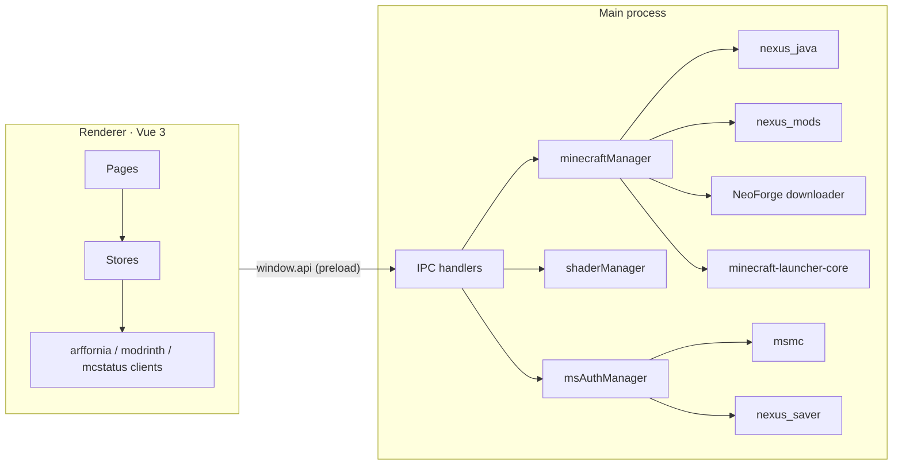

# Launcher

**Repo:** [Arffornia_Launcher_V.5.2](https://github.com/Arffornia/Arffornia_Launcher_V.5.2) ·
**Stack:** Electron, electron-vite, Vue 3, Pinia, vue-i18n (plain JavaScript)

The desktop app players install. It signs the player in with Microsoft, installs a Java 21
runtime, the NeoForge installer and the modpack, then starts Minecraft 1.21.1. It also shows
shop, ranking and server-status data and lets players browse and install shaders.



## Talks to

| What | Where | Notes |
|---|---|---|
| Website API (read-only) | `arffornia.com/api/…` profile, rankings, shop, launcher images | no auth |
| Mod list and files | `Arffornia_Provisioning` `config/launcher/` on GitHub `main` | synced by `nexus_mods` |
| Mods | CurseForge (via `api.curse.tools`), Modrinth, GitHub releases | |
| Java runtime | Azul API and CDN, via `nexus_java` | |
| Minecraft | Mojang, NeoForge Maven, Microsoft / Xbox login (msmc) | |
| Updates | GitHub Releases of the launcher (electron-updater) | |

## Develop

```bash
npm ci
npm run dev      # electron-vite dev
make check       # lint + tests + build
```

Game data lives in `./.Arffornia_V.5.2` relative to the working directory today
(moving it to the OS user-data folder is tracked as an issue).

## Known gaps (October 2026 audit)

Electron hardening (sandbox, IPC validation, CSP), secure token storage, unsigned updates,
missing hash checks on downloads, no tests yet. All tracked as issues in milestone M1/M2.
