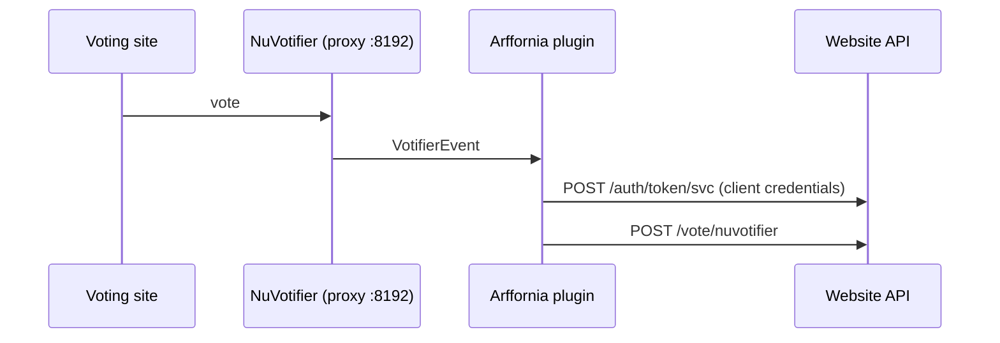

# Proxy plugin

**Repo:** [Arffornia_Proxy](https://github.com/Arffornia/Arffornia_Proxy) ·
**Stack:** Velocity plugin, Java 17, Gradle

Players connect to a **Velocity** proxy, which forwards them to the game server with modern
forwarding. Routing, online mode and the forwarding secret are Velocity configuration,
managed in [infra](infra.md) and [provisioning](provisioning.md).

The proxy's main role is the **network entry point**: every player connects through it. The
Arffornia plugin adds network features on top:

- **Server-list MOTD**: a git-versioned `motd.yml` (Provisioning) with random quotes and dated
  entries (Halloween, Christmas, New Year, April 1st, the anniversary), in EN and FR. The ping
  carries no language, so the plugin reuses the language of players who joined recently from the
  same address. Preview any day with `/motdpreview 2026-12-25 fr`
  ([proxy#16](https://github.com/Arffornia/Arffornia_Proxy/pull/16)).
- **Votes**: receives **NuVotifier** votes from voting sites and forwards them to the website
  (`POST /api/vote/nuvotifier`) with a service-account token, so the website can credit
  points and rewards.



## Develop

```bash
./gradlew build
./gradlew runVelocity   # local proxy with the plugin
```
