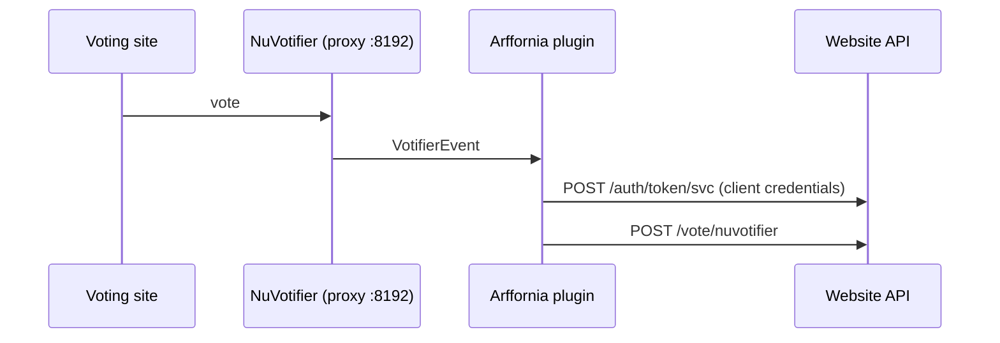

# Proxy plugin

**Repo:** [Arffornia_Proxy](https://github.com/Arffornia/Arffornia_Proxy) ·
**Stack:** Velocity plugin, Java 17, Gradle

Players connect to a **Velocity** proxy, which forwards them to the game server with modern
forwarding. Routing, online mode and the forwarding secret are Velocity configuration,
managed in [infra](infra.md) and [provisioning](provisioning.md).

The Arffornia plugin has one job: receive **NuVotifier** votes from voting sites and forward
them to the website (`POST /api/vote/nuvotifier`) with a service-account token, so the
website can credit points and rewards.



## Develop

```bash
./gradlew build
./gradlew runVelocity   # local proxy with the plugin
```
