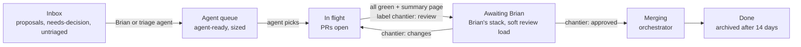

# Operating model: agents build, Brian validates chantiers

Most work on Arffornia is done by autonomous AI agents. The maintainer, Brian, no longer reviews
or merges pull requests one by one. He validates **chantiers**: one page per group of PRs, with
the decisions he has to take and what was verified. After his approval an orchestrator merges
the group in order. This page is the rule set; [ADR-0008](../decisions/0008-chantiers-and-board-projection.md)
records the decision and the research behind it.

## Why the old board stopped working

The org board had about 230 rows, most of them in two columns. 68 issues had an open PR that
closes them, so the same work appeared twice. Agents produced PRs faster than one person can
read them, and the summaries were scattered across chat messages and artifacts.
The industry sees the same thing: review, not code generation, is the bottleneck, and the fix
is to review *intent and risk* per unit of change, not every line
([sources](#sources)).

## Principles

1. **The unit of human attention is the chantier**, not the issue or the PR.
2. **Brian's stack is ordered, not capped.** He unstacks it from the top, in evening and weekend
   batches, so there is no hard limit on what waits or what is in flight. The stack shows a soft
   **review load** instead (cards waiting, estimated minutes); agents group small chantiers when
   it grows, and say so in the weekly brief.
3. **Labels are the source of truth; the board is a projection.** Agents can set labels over
   REST from any session. A scheduled job recomputes the board fields.
4. **Agents open their PRs; they merge only approved chantiers.** An orchestrator merges a
   chantier only after Brian added `chantier: approved`, with merge commits, in the listed order.
5. **Every decision comes with a recommended default.** Brian can approve all defaults at once.
6. **Evidence over prose.** A chantier says what was run, what passed and what was *not* checked.
7. **Small board.** PRs live inside chantiers, not as rows. Finished items are archived.
8. **Ideas are never lost.** Proposals wait in a separate inbox. After 30 days without activity
   they count as *dormant*: the weekly brief resurfaces them, nothing closes them. Brian may be
   away for months; his proposals are still there when he comes back.

## The units

| Unit | What it is | Who creates it | Lives in |
|---|---|---|---|
| Issue | One outcome an agent can deliver, with acceptance criteria | agents, Brian | the repo it changes |
| Pull request | One agent's output for one issue (or a tight group of S issues) | agents | the repo it changes |
| **Chantier** | Parent issue grouping PRs, decisions, merge order and a summary page | the agent that finishes the work | `Arffornia/docs`, label `chantier` |
| Proposal | An idea, not yet work | anyone | the repo it concerns, label `proposal` |
| Decision | A question only Brian can answer, with a default | agents | a checkbox in a chantier, or a `needs-decision` issue |

A chantier is typically 3 to 15 PRs that make sense together (one stack, one feature, one
hardening pass) and can be reviewed in about 10 minutes from its page.

## Lanes



| Lane | An item is here when | Leaves when |
|---|---|---|
| Inbox | `proposal` or `needs-decision`, or no triage label | Brian promotes it (`agent-ready`), answers it, or closes it himself (never automatically) |
| Agent queue | `agent-ready` and no open PR closes it | a PR with `Closes #n` is opened |
| In flight | an open PR exists, or its chantier has no state label or `chantier: changes` | the chantier gets `chantier: review` |
| Awaiting Brian | its chantier has `chantier: review` | Brian adds `chantier: approved` or `chantier: changes` |
| Merging | its chantier has `chantier: approved` | the orchestrator closes the chantier |
| Done | closed or merged | archived after `ARCHIVE_DONE_DAYS` |

Members of a chantier (its PRs and issues) follow the chantier's lane, so they leave the
other columns as soon as they are grouped.

## Labels and board fields

Labels (set by agents or Brian, over REST or in the UI):

| Label | Meaning |
|---|---|
| `chantier` | this issue is a chantier (only in `Arffornia/docs`) |
| `chantier: review` | ready for Brian: every PR green, summary page published |
| `chantier: approved` | Brian approved; the orchestrator may merge |
| `chantier: changes` | Brian asked for changes; see his comment |
| existing `type:*`, `area:*`, `priority:*`, `effort:*`, `agent-ready`, `needs-decision`, `proposal` | unchanged, see [workflow](workflow.md) |

Board fields (managed by `scripts/sync_board.py`; do not edit them by hand, they are recomputed every hour):

| Field | Type | Values | Source |
|---|---|---|---|
| Lane | single select | Inbox, Agent queue, In flight, Awaiting Brian, Merging, Done | labels, PR links, chantier state |
| Decision | single select | Drafting, Pending, Approved, Changes requested, Closed | chantier labels |
| Chantier | text | `#12 Launcher security` | set on members only |
| Order | number | 1, 2, 3… | chantier form "Stack order" |
| Agent | single select | Claude Code, Codex, OpenCode, Copilot, Human | chantier form |
| Risk | single select | A merge on green · B look at one thing · C needs a manual test | chantier form |
| Area, Priority | single select | from `area:*`, `priority:*` | filled once; manual edits win |

## Views

The sync job creates these views over REST. If a view is missing (the run summary lists it),
create it by hand with the steps below.

| View | Layout | Filter | Sort / group |
|---|---|---|---|
| **Brian's stack** | table | `label:chantier lane:"Awaiting Brian"` | sort Order ascending |
| Pipeline | board | `no:chantier -lane:Done` | columns: Lane |
| Agent queue | table | `lane:"Agent queue" no:chantier` | sort Priority ascending |
| In flight | table | `lane:"In flight"` | group Repository |
| Merging | table | `label:chantier lane:Merging` | sort Order ascending |
| Inbox | table | `lane:Inbox` | group Area |

Creating a view by hand, on <https://github.com/orgs/Arffornia/projects/3>:

1. Click **+ New view** at the right of the view tabs, then choose **Table** or **Board**.
2. Open the menu (▾) on the new tab, choose **Rename**, type the name from the table.
3. Click the filter bar, paste the filter, press Enter.
4. In the same menu: **Sort by** → the field and direction, or **Group by** → the field. For a
   board, **Column by** → Lane.
5. Click **Save** (the button appears next to the view name once the view changed).

Two settings only exist in the UI:

- **Column limits (optional, off by default).** GitHub can show a count against a limit on a
  board column (**⋯** → **Set limit**). We do not set one: Brian reviews in batches.
- **Auto-archive.** Project **⋯** menu (top right) → **Workflows** → **Auto-archive items** →
  **Edit** → filter `is:closed updated:<@today-14d` → **Save and turn on**. This replaces
  `ARCHIVE_DONE_DAYS` if you prefer GitHub to do it.

## How an agent works

1. **Pick.** Take the top item of *Agent queue* in your area, by priority. Before starting,
   run `python3 scripts/chantiers.py --wip` to see the review load; when many small chantiers
   wait, group related work into one chantier instead of opening another.
2. **Build.** One branch and one PR per issue, `Closes #n` in the body, `make check` green.
   Stack PRs only when one really needs the other.
3. **Self-review at the end of the task**, in the agent's own session (a second, read-only
   reviewer pass, as the repo's `REVIEW.md` says). There is no AI review in CI and no API key
   in GitHub.
4. **Group.** When the PRs of one outcome are green, open a chantier in `Arffornia/docs` with
   the **Chantier** form: summary page link, PRs in merge order, issues closed, decisions with
   defaults, verified / not verified, risk, agent, stack order. Add same-owner issues as
   sub-issues.
5. **Hand over.** Add `chantier: review`. The chantier now appears in Brian's stack.
6. **Iterate.** On `chantier: changes`, read Brian's comment, push fixes, update the page,
   put `chantier: review` back.

An agent that notices something off-scope (a bug, a better skill, a harness gap) opens a
`proposal` issue instead of widening its chantier.

## The summary page

One page per chantier, published as an artifact or a docs page. It has, in this order:

1. **What and why** in three lines.
2. **Decisions**, each with the recommended default and the cost of the other option.
3. **PRs in merge order**: full URL, one line each, risk class, what to look at.
4. **Verified / not verified**: commands and results; what could not run here and why.
5. **After merge**: anything Brian must do (rotate a secret, restart a deployment, add a token).

## How Brian works

1. Open the **Brian's stack** view (or the latest *board-sync* run summary). Take the top chantier.
2. Read its summary page. Tick the decisions you accept, answer the others in a comment.
3. Add `chantier: approved`, or `chantier: changes` with a comment. That is all.

## How the orchestrator merges

The orchestrator is an agent session (or Brian) running:

```sh
python3 scripts/chantiers.py --merge-plan 12            # dry run: ordered steps
python3 scripts/chantiers.py --merge-plan 12 --execute  # merges, comments, closes the chantier
```

- It refuses unless `chantier: approved` was added by an approver (`APPROVERS`, default
  `TheGostsniperfr`). An agent adding the label itself does not count.
- It merges with `gh pr merge --merge` (merge commits: squash breaks stacked PRs) in the listed
  order, and stops at the first PR that is draft, closed, conflicting or not yet retargeted.
- **Stacked PRs.** Merging a base PR merges its commits into the default branch; GitHub then
  retargets the next PR when the base branch is deleted. In **Nexus_Java, Nexus_Logger and
  Nexus_Saver** "delete branch on merge" is off, so the orchestrator deletes the merged base
  branch itself before merging the next PR.
- **Merge queue.** If a repository turns on a merge queue (available for public org repos),
  `gh pr merge` adds the PR to the queue and the script waits for it to merge before the next
  one. Workflows must then also run on `merge_group`. The queue only takes PRs that target the
  default branch, so stacked PRs still go one by one. `TheGostsniperfr/infra` is a personal
  repo: no merge queue there.
- After the last merge it comments the merged list on the chantier and closes it.

## Keeping the board small

- PRs are not added as rows when they close an issue or belong to a chantier (`BOARD_PRS=unlinked`).
- Done items are archived after 14 days (`ARCHIVE_DONE_DAYS`, or the built-in workflow above).
- `needs-decision` issues are grouped into decision chantiers rather than left alone.
- Proposals are never closed automatically. One with no activity for 30 days is *dormant*: the
  weekly brief lists it under "Dormant proposals resurfaced" so it comes back to Brian's
  attention; only Brian closes a proposal.

## Agent task queue: GitHub issues, with Beads as an option

Brian asked whether [Beads](https://github.com/steveyegge/beads) (an issue tracker built for
coding agents) should replace or complement the board. Evaluated 2026-10-31:
- What it is: `bd`, MIT, about 28k stars. Issues live in a Dolt database (a versioned SQL
  database) inside `.beads/`, synced through a git ref. `bd ready` lists work with no open
  blocker, `--claim` takes an item atomically, dependencies are first-class, agents can message
  each other. It has **no GitHub Issues sync**.
- Verdict: **complement, not replace.** GitHub issues stay the shared record: Brian, contributors
  and PRs (`Closes #n`) use them, chantiers link them, and the board projects them. Beads would
  add a second source of truth for the same work.
- Where it fits: as an agent's scratch queue *inside* one large chantier when several agents work
  on it in parallel (claims, blockers, hand-offs), kept in the private ops repo and summarised
  back into the chantier issue. Today GitHub sub-issues and "blocked by" links cover our size.
- Default: do not adopt now; trial it on the first chantier that runs three or more agents in
  parallel.

## Sources

The research behind this page (with dates) is summarised in
[ADR-0008](../decisions/0008-chantiers-and-board-projection.md). Main sources:
Anthropic, [Effective harnesses for long-running agents](https://www.anthropic.com/engineering/effective-harnesses-for-long-running-agents) (2025-11-26) ·
Linear, [Agent Interaction Guidelines](https://linear.app/developers/aig) (2025-07-30) ·
GitHub, [Reviewing Copilot PRs](https://docs.github.com/en/copilot/how-tos/use-copilot-agents/cloud-agent/review-copilot-prs) ·
Addy Osmani, [Your AI coding agents need a manager](https://addyosmani.com/blog/coding-agents-manager/) (2026-01-08) ·
Semgrep, [The end is nigh for code review](https://semgrep.dev/blog/2026/end-is-nigh-for-code-review) (2026-10-09) ·
GitHub REST, [project views](https://docs.github.com/en/rest/projects/views) and [sub-issues](https://docs.github.com/en/rest/issues/sub-issues) ·
GitHub, [merge queue](https://docs.github.com/en/repositories/configuring-branches-and-merges-in-your-repository/configuring-pull-request-merges/managing-a-merge-queue).
