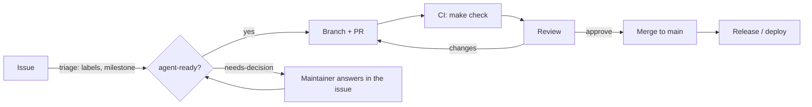

# Workflow

## Issues

| Label | Meaning |
|---|---|
| `type:*` | bug, security, feature, deps, test, docs, ci, refactor |
| `area:*` | website, launcher, mod, proxy, provisioning, libs, infra, ai |
| `priority:P0…P3` | P0 now (security, data loss) · P1 next · P2 planned · P3 nice to have |
| `effort:S/M/L` | under half a day · 1–3 days · more |
| `agent-ready` | acceptance criteria written, no open design question |
| `needs-decision` | blocked on the maintainer |
| `proposal` | an idea; the maintainer decides whether it becomes work |

Milestones: **M1 · Foundation & security**, **M2 · Tests & CI**, **M3 · Gameplay foundations**.

All issues show up on the org board **Arffornia Roadmap**.

## Branches and commits

- Branch from `main`: `fix/…`, `feat/…`, `security/…`, `test/…`, `ci/…`, `docs/…`, `chore/…`.
- [Conventional Commits](https://www.conventionalcommits.org/): `fix(launcher): await auth before download`.
- One concern per PR. Link the issue with `Closes #n`.

## Pull requests

The template asks for **What**, **Why**, **How it was tested** and **Risk & revert**.
CI must be green. The maintainer merges; agents never merge.

## Releases

| Component | How it ships |
|---|---|
| Launcher | tag `v*` → GitHub Release → electron-updater |
| Mod, proxy plugin | tag `v*` → GitHub Release → picked up by the modpack lists |
| Website | image on GHCR → Argo CD in `infra` |
| Provisioning | `main` is live: servers resync at start, launchers at launch |
| Nexus libraries | npm publish (tag-triggered workflow) |
