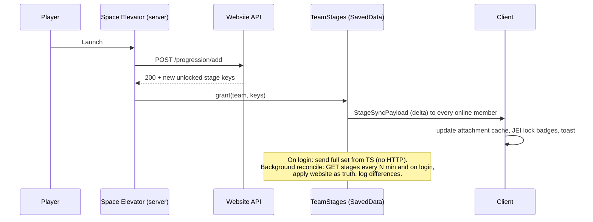

# 001 · Machine recipes as a datapack, with stage gating

| | |
|---|---|
| **Status** | Draft: needs decisions |
| **Milestone** | M3 · Gameplay foundations |
| **Repos** | Arffornia_Mods, Arffornia_Website, Arffornia_Provisioning |
| **Related** | [ADR-0006](../decisions/0006-recipes-as-datapack.md) · issues Mods [#14](https://github.com/Arffornia/Arffornia_Mods/issues/14), [#16](https://github.com/Arffornia/Arffornia_Mods/issues/16), [#18](https://github.com/Arffornia/Arffornia_Mods/issues/18), [#27](https://github.com/Arffornia/Arffornia_Mods/issues/27), [#28](https://github.com/Arffornia/Arffornia_Mods/issues/28), [#29](https://github.com/Arffornia/Arffornia_Mods/issues/29) · [002](002-machine-framework.md), [003](003-machine-tier-plan.md) |

## Summary

Replace the HTTP-fetched Crafter recipes and the runtime recipe ban with standard Minecraft
data: a real `arffornia:machine` recipe type, delivered in a **datapack generated by the
website**, dropped into the world by provisioning. Each gated recipe chooses its mode:
**machine-only** (the original recipe is disabled, a machine recipe replaces it) or
**stage-locked** (the original crafting-table recipe stays, but only works once the
player's team has the stage). Unlocked stages live in a **data attachment** on the server,
synced to the client, so gating never calls HTTP on a hot path. JEI reads everything from
the `RecipeManager`.

## Goals

- One source of truth (the website editor), one delivery path (a datapack), no client HTTP
  for recipes.
- Lossless recipes: tags, components, counts, remainders, chances, fluids.
- Gating that fails **closed**: if the website is down, the last datapack still applies.
- Per-recipe gating mode: machine-only or stage-locked in place.
- Stage checks are synchronous and server-authoritative; the client only displays.
- Reviewable files: a recipe change is a diff; CI boots a GameTest server against it.

## Non-goals

- The machines themselves (see [002](002-machine-framework.md)) and the tier content (see
  [003](003-machine-tier-plan.md)).
- Rewriting the progression graph screen or the website editor UI beyond the export.
- Replacing KubeJS for pack tweaks: KubeJS scripts in Provisioning keep working and can add
  `arffornia:machine` recipes with `event.custom`.

## Player experience

| Situation | What the player sees |
|---|---|
| Item gated **machine-only**, stage locked | JEI shows the machine recipe with a lock badge and the stage name ("Requires: Stage 2 · Steel"). The crafting-table recipe does not exist. |
| Item gated **machine-only**, stage unlocked | The machine lists the recipe in its selector; JEI "+" fills the machine. |
| Item gated **stage-locked**, stage locked | The crafting table shows the result greyed out with a lock icon and a tooltip "Unlocks at Stage 2 · Steel"; taking it is impossible. JEI shows the recipe with the lock badge. |
| Item gated **stage-locked**, stage unlocked | Normal crafting. |
| Stage just completed (Space Elevator launch) | Toast "Stage 2 · Steel unlocked: 14 recipes", JEI refreshes lock badges, open machine screens update. |
| Player joins another FTB team | Stages switch to the new team's set at once (see D3). |

All strings are lang keys in `en_us` and `fr_fr` ([ADR-0002](../decisions/0002-english-codebase-bilingual-players.md)).
Stage display names come from the datapack (`stage` files, below) with `en`/`fr` keys.

## Design

### Vocabulary

- **Stage key**: stable string id of an unlockable step, e.g. `arffornia:stage2/steel`.
  Today the website gates per *milestone*; the key is the milestone's stable slug, so
  "stage" here means "an unlockable progression node" (see D2). Never a DB integer.
- **Gate**: a rule "this recipe needs stage X", in mode `machine` or `crafting`.

### Data model (datapack)

```
arffornia_progression/                    # generated by the website, one zip
├── pack.mcmeta                           # pack_format 48 (1.21.1 data)
└── data/
    ├── arffornia/
    │   ├── arffornia/stage/<key>.json            # display names, icon, order
    │   ├── recipe/machine/<machine>/<id>.json    # machine recipes
    │   └── recipe/staged/<ns>/<id>.json          # stage-locked wrappers
    └── <ns>/recipe/<id>.json                     # overrides that disable originals
```

Machine recipe (`type: arffornia:machine`):

```json
{
  "type": "arffornia:machine",
  "machine": "arffornia:assembler",
  "stage": "arffornia:stage2/steel",
  "ingredients": [
    {"ingredient": {"tag": "c:plates/iron"}, "count": 3},
    {"ingredient": {"item": "minecraft:redstone"}, "count": 2}
  ],
  "fluid_ingredients": [],
  "results": [{"id": "mekanism:basic_control_circuit", "count": 1}],
  "chance_results": [{"result": {"id": "minecraft:iron_nugget"}, "chance": 0.25}],
  "energy": 4000,
  "time": 100,
  "neoforge:conditions": [{"type": "neoforge:mod_loaded", "modid": "mekanism"}]
}
```

- `ingredients`: NeoForge `SizedIngredient` (tags, components, counts).
- `results`: `ItemStack` codec (components kept). Fluids use `SizedFluidIngredient` / `FluidStack`.
- `energy` is total FE; cost per tick is `ceil(energy / time)` (fixes the current rounding bug).
- `stage` is optional (ungated machine recipes are allowed).

Disable an original recipe (machine-only gate), at the original path:

```json
{"neoforge:conditions": [{"type": "neoforge:false"}]}
```

Stage-locked wrapper (crafting gate), at the original path so it **replaces** the original:

```json
{
  "type": "arffornia:staged",
  "stage": "arffornia:stage2/steel",
  "recipe": { "type": "minecraft:crafting_shaped", "...": "original recipe JSON, verbatim" }
}
```

The wrapper delegates `matches`/`assemble`/serialization to the inner recipe and adds the
stage check. Replacing at the same id keeps advancements, recipe book and other mods'
references working.

Stage file (`data/arffornia/arffornia/stage/stage2/steel.json`):

```json
{"name": {"en": "Steel", "fr": "Acier"}, "icon": "minecraft:iron_block", "tier": 2, "order": 10}
```

The `name` shape depends on D6 (inline `en`/`fr` text shown here, or a lang key).

### Mod code structure (`fr.thegostsniperfr.arffornia`)

| Package / class | Role |
|---|---|
| `recipe.MachineRecipe` (record) | fields above; `matches(MachineRecipeInput, Level)` = all sized ingredients satisfied by distinct slots |
| `recipe.MachineRecipeInput` | `RecipeInput` over the machine's input `IItemHandler` + fluid tanks |
| `recipe.MachineRecipeSerializer` | `MapCodec` (JSON) + `StreamCodec` (network) |
| `recipe.StagedRecipe<T>` + serializer | wrapper for crafting-table gating; codec embeds `Recipe.CODEC` |
| `recipe.ModRecipes` | `DeferredRegister` for `Registries.RECIPE_TYPE` / `RECIPE_SERIALIZER` |
| `stage.StageRegistry` | reload listener loading `arffornia/stage/*.json` (codec), synced to clients on login and reload |
| `stage.TeamStages` | `SavedData` on the overworld: `teamId → Set<String>` (authoritative store) |
| `stage.PlayerStages` | `AttachmentType<Set<String>>` on the player: a **cache** of the team's set, `copyOnDeath`, no persistence needed |
| `stage.StageService` | `has(Player, key)`, `grant/revoke(team, key)`, recompute on team change; pushes sync payload |
| `stage.StageSyncPayload` | `playToClient`: full set on login, delta on change |
| `stage.CraftingPlayerContext` | ThreadLocal set by a mixin around `CraftingMenu.slotChangedCraftingGrid` (and the inventory 2×2 grid) |
| `compat.jei.*` | one category per machine from `getAllRecipesFor(MACHINE)` filtered by `machine`; lock overlay; staged recipes shown in the vanilla crafting category with a lock |
| `compat.kubejs` (optional) | none needed; `event.custom` already works with the codec |

Why the mixin: `CraftingInput` carries no player in 1.21.1, so `StagedRecipe.matches` cannot
know who crafts. The well-known approach (used by Recipe Stages) sets the crafting player
in a ThreadLocal around result computation. Automated crafters (AE2, RS, Create mechanical
crafter, Crafting Station) have no player: `StagedRecipe` then checks the **block
owner's** stages when the mod exposes one, else denies (see D4).

### Stage source and sync



- The world (SavedData) is the runtime authority, the website is the system of record.
  A reconcile job fixes drift; a website outage never unlocks or relocks anything.
- Commands `/arffornia stage grant|revoke|list <team|player> <key>` for admins and tests.

### Website export

| Item | Spec |
|---|---|
| Endpoint | `GET /api/progression/datapack` → `application/zip`, `ETag` = sha256 of content; `GET /api/progression/datapack.sha256` for cheap polling |
| Auth | service account role `progression_reader` (new) or public; recipes are not secret (D5) |
| Determinism | sorted file list, fixed zip timestamps, stable JSON key order, so identical data gives identical bytes |
| Schema changes | `recipes`: add `machine` (string), `recipe_json` (JSON, the full `arffornia:machine` body), `gate_mode` (`machine` / `crafting`); `milestones`: add `stage_key` (unique slug); `milestone_unlocks.recipes_to_ban` kept and reused as the list of original ids to disable or wrap |
| Validation | Laravel FormRequest validates `recipe_json` against a JSON Schema committed in the mod repo (`schema/machine_recipe.schema.json`), so the editor cannot store what the mod cannot load |
| Capture tool | `/arffornia progression addunlock` serializes the **original recipe with its own codec** (`Recipe.CODEC.encodeStart`) and posts the JSON; no more flattening |
| Snapshot | a GitHub Action in Provisioning (nightly + manual) downloads the zip, unpacks it into `config/server/storage/world/datapacks/arffornia_progression/` and opens a PR, so every recipe change is a reviewed diff (D1) |

### Provisioning drop-in

- The unpacked datapack is a normal folder under `config/server/storage/world/datapacks/`;
  `generateIndexes.ts` indexes it like any other file and config-updater copies it at start.
- Mark these files `override: true` so stale recipes are replaced.
- Hot update without restart: `/arffornia datapack pull` (admin) downloads the zip into
  `world/datapacks/`, verifies the sha256, then runs `/reload`. Optional, behind D1.

### What gets deleted from the mod

`ClientRecipeCache`, `CustomRecipeManager`, `RecipeBanManager`, `migrateOnStartup`,
`ProgressionBackend.fetchAllCustomRecipes/fetchProgressionConfig`, the client calls for
recipes, the `linkedProgressionId` on Crafters (replaced by team stages).

## Testing

| Layer | Test |
|---|---|
| Unit (junit-fml) | codec round-trip JSON → `MachineRecipe` → `StreamCodec` → equal; `StagedRecipe` wraps shaped, shapeless, smithing, and a modded type; energy per tick = ceil; schema fixture files from the website test suite parse (contract test) |
| GameTest | `machine_recipe_crafts_with_stage` / `..._blocked_without_stage`; `staged_crafting_table_denies_then_allows` (fake player, grant stage mid-test); `disabled_recipe_absent` (`RecipeManager.byId` empty); `stage_survives_relog_and_death`; `team_switch_changes_stages`; `select_locked_recipe_rejected` (server check) |
| Datagen check | CI runs `runData` and `git diff --exit-code src/generated` |
| Datapack lint (CI, Provisioning) | boot `runGameTestServer` with the snapshot datapack; fail on any "Couldn't parse data file" log line or unknown item/tag; count of disabled ids that do not exist (warn) |
| Website | Feature test: export zip is deterministic (two calls, same sha); every row validates against the schema |
| Client (nightly harness, see M2) | JEI shows the lock badge; lang keys resolve in `fr_fr` |

Docs: [NeoForge recipes](https://docs.neoforged.net/docs/1.21.1/resources/server/recipes/),
[data load conditions](https://docs.neoforged.net/docs/1.21.1/resources/server/conditions),
[data attachments](https://docs.neoforged.net/docs/1.21.1/datastorage/attachments),
[GameTests](https://docs.neoforged.net/docs/1.21.1/misc/gametest).

## Migration from the current system

1. Ship the recipe type and stage store behind the old system (both run; old Crafter still
   reads HTTP). No player-visible change.
2. Website migration: add columns; a one-off artisan command converts each `recipes` row to
   `recipe_json` (`ingredients[i].item` → `SizedIngredient`, `result` → `results`,
   `machine = arffornia:crafter`, `stage = milestone.stage_key`, `gate_mode = machine`).
   Rows with lossy data (former tag recipes) are flagged for manual review.
3. Backfill `stage_key` for every milestone (slug of stage number + name, editable).
4. Backfill team stages: one-off command on the server reads every progression's completed
   milestones from the API and writes `TeamStages`.
5. First export + Provisioning PR; boot a preview server; compare: same items craftable,
   same items banned (a GameTest lists both sets and diffs against the old API output).
6. Switch: remove the HTTP recipe code and `RecipeBanManager`; set `migrateOnStartup` gone.
7. Re-capture lossy recipes with the new lossless `addunlock`.

Rollback: the previous mod version and the old API endpoints stay until step 6 ships in a
release; the datapack folder can be deleted to return to the old behaviour.

## Decisions needed

| # | Question | Options | Recommendation |
|---|---|---|---|
| D1 | How does the datapack reach servers? | (a) Provisioning PR snapshot (reviewed, restart to apply); (b) server pulls the zip at boot and on `/arffornia datapack pull`; (c) both | **(c)**: (a) is the normal path, reviewable and reproducible; (b) is an admin hot-fix path |
| D2 | What is the gating unit: milestone or stage? | (a) per milestone (today's model, fine-grained); (b) per stage (coarse, simpler to read) | **(a)** keyed by a stable milestone slug, with the stage number in the key prefix for readability |
| D3 | Progression scope (issue #18) | (a) per player; (b) per FTB team; (c) per progression entity (as today) | **(b) per FTB team**, solo players are a team of one (FTB Teams already does this); matches the website's `teams.progression_id` |
| D4 | Gating mode default and automated crafters | (a) machine-only everywhere (today); (b) stage-locked in place everywhere; (c) per recipe, default machine-only | **(c)**. Machine-only for anything that should feel "industrial"; stage-locked for vanilla/basic items. Automated crafters without an owner are denied for stage-locked recipes |
| D5 | Is the export endpoint public? | (a) public; (b) service token | **(a) public** read-only, rate-limited: recipes are visible in JEI anyway |
| D6 | Where do stage display names live? | (a) lang keys in the mod (needs a mod release per new stage); (b) literal `en`/`fr` text in the stage JSON; (c) a generated resource pack | **(b)** for M3 (`{"name": {"en": "...", "fr": "..."}}`, resolved by client locale); revisit if more languages come |

When D1–D6 are answered, update ADR-0006 to `accepted` with these choices.

## Work breakdown

| # | Title | Repo | Acceptance criteria | Effort |
|---|---|---|---|---|
| 1 | Implement `arffornia:machine` recipe type and serializer | Mods | Recipe JSON in `data/arffornia/recipe` loads; codec round-trip unit tests; JSON Schema committed; synced to client | M |
| 2 | Add the stage store: `TeamStages`, player attachment cache, sync payload, admin commands | Mods | Stages survive restart, relog and death; team switch updates; GameTests; closes the two "progression changed" TODOs | M |
| 3 | Load stage definitions from datapack (`arffornia/stage`) | Mods | Stages listed by `/arffornia stage list`; names resolve in en/fr | S |
| 4 | Update the website stage set on milestone completion and reconcile on login | Mods | Elevator launch grants keys from the API response; reconcile logs drift; no HTTP in tick paths | S |
| 5 | Implement `arffornia:staged` wrapper + crafting player mixin | Mods | Shaped/shapeless/smithing wrapped; locked result greyed with tooltip; GameTest deny-then-allow; mixin config declared in `neoforge.mods.toml` | M |
| 6 | JEI: categories from `RecipeManager`, lock overlay, transfer handler | Mods | No `ClientRecipeCache` use; recipes appear after `/reload`; locked recipes show stage name | M |
| 7 | Website: schema columns, `stage_key`, conversion command | Website | Migration + command; every converted row validates against the schema; flagged rows listed | M |
| 8 | Website: deterministic datapack export endpoint | Website | Zip with recipes, overrides, wrappers, stages; same sha for same data; feature test | M |
| 9 | Lossless `addunlock`: post the original recipe JSON via its codec | Mods + Website | Tag recipe captured keeps the tag; endpoint stores `recipe_json` | S |
| 10 | Provisioning: snapshot workflow and datapack lint | Provisioning | Nightly/manual PR with the unpacked pack; CI boots GameTest server with it and fails on parse errors | M |
| 11 | Optional: `/arffornia datapack pull` hot update | Mods | Downloads, verifies sha256, `/reload`; admin-only; timeout and error message | S |
| 12 | Remove the HTTP recipe path | Mods | `ClientRecipeCache`, `CustomRecipeManager`, `RecipeBanManager`, `migrateOnStartup` deleted; clients make no recipe HTTP calls | S |
