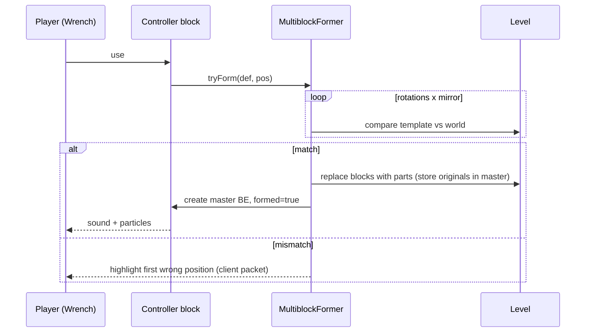

# 002 · Machine framework and multiblocks

| | |
|---|---|
| **Status** | Draft: needs decisions |
| **Milestone** | M3 · Gameplay foundations |
| **Repos** | Arffornia_Mods |
| **Related** | issues Mods [#17](https://github.com/Arffornia/Arffornia_Mods/issues/17), [#30](https://github.com/Arffornia/Arffornia_Mods/issues/30), [#31](https://github.com/Arffornia/Arffornia_Mods/issues/31) · [001](001-recipes-datapack.md) (recipes, stages), [003](003-machine-tier-plan.md) (which machines) |

## Summary

A small framework so that a new machine is **one `MachineType` definition, a model and a
texture**, not a new set of classes. It covers single-block machines (Constructor-class)
and **template multiblocks formed with the Wrench**, in the style of Immersive Engineering
but with a cleaner, futuristic, Satisfactory-like look. Every machine shares the same
parts: slot layout, side configuration, energy buffer, recipe processor, synced data, and
one menu/screen base built on an in-game GUI design system. The current Crafter and Space
Elevator are ported onto it.

## Goals

- Adding a machine: register a `MachineType`, add a blockstate/model/texture, add lang keys,
  add recipes as data. No new Java for standard machines.
- Correct automation: per-face item/fluid/energy IO, hopper and pipe friendly, no dupes.
- Multiblocks defined as structure templates, previewable, formed with the Wrench, broken
  back into their original blocks.
- One GUI look for every machine (Paladium-level polish), EN/FR, readable at all GUI scales.
- Server-authoritative; client gets only what the screen needs.
- Covered by GameTests from the first machine.

## Non-goals

- Dynamic-size multiblocks (Mekanism style). Fixed templates only in M3.
- Upgrades/overclocking items beyond a slot role reserved for them (see D5).
- Custom energy networks: machines use NeoForge `IEnergyStorage` (FE) so every pack
  generator and cable works.
- Animations beyond simple state changes (on/off, working) in M3.

## Player experience

- **Single-block machine:** place it, open it. Left: inputs; centre: recipe selector and
  progress; right: outputs; bottom: energy bar and status ("Working", "No power", "Output
  full", "Locked: Stage 3"). A side-config tab shows a 3D-ish cube net; click a face to
  cycle None / Input / Output / Both, per resource (items, fluids, energy). The Wrench
  shift-click cycles the face you look at; the Wrench click rotates.
- **Recipe selection (Satisfactory-like):** a machine runs one selected recipe at a time.
  The selector lists the recipes this machine can run, locked ones greyed with the stage.
  Selecting a recipe shows "ghost" items in the slots so the player sees what to feed;
  automation only inserts matching items. "Auto" mode (first matching recipe) is optional
  per machine (D3).
- **Multiblock:** build the structure from a hologram shown by a **Blueprint** item (or the
  manual), right-click the controller block with the Wrench. If valid, the blocks turn into
  the finished machine model with a short "assembly" effect. If not, the first wrong
  position is highlighted with the expected block in a tooltip. Breaking any part returns
  the original blocks.
- **Info:** Jade/WTHIT tooltip shows status, progress, energy, current recipe.

## Design

### Code structure (`fr.thegostsniperfr.arffornia.machine`)

| Class | Role |
|---|---|
| `MachineType` (record) | id, `SlotLayout`, `EnergySpec`, `TankSpec`s, recipe `machine` id, `SideConfigDefaults`, `MultiblockDef?`, sounds, GUI layout id, tier |
| `MachineTypes` | registry: `DeferredRegister` helper that creates block, item, BE type and menu type from a `MachineType` |
| `MachineBlock` | horizontal facing, `ACTIVE` property, wrench rotate, drops contents |
| `MachineBlockEntity` | owns the parts below; ticks `RecipeProcessor` on the server only |
| `SlotLayout` | ordered slots with role `INPUT`/`OUTPUT`/`CATALYST`/`UPGRADE`/`FLUID_ITEM`, GUI x/y, filter |
| `MachineItemHandler` | `ItemStackHandler` + role checks; exposes role-filtered views |
| `MachineEnergyStorage` | clamped `EnergyStorage`, `onChanged → setChanged`, configurable max in/out |
| `MachineFluidTanks` | 0..n `FluidTank`s with role |
| `SideConfig` | per face × resource → `NONE/IN/OUT/BOTH`; NBT + codec; relative to facing |
| `RecipeProcessor` | state machine: `IDLE → CHECK → RUNNING → OUTPUT_BLOCKED`; caches the selected `RecipeHolder<MachineRecipe>`; checks stage of the owner team (spec 001) at start; consumes inputs at start, energy per tick, commits outputs at end; pauses (does not reset) without power |
| `MachineData` | `ContainerData` with progress, max progress, energy (split int), status enum |
| `MachineMenu` | slots from `SlotLayout`, player inventory, `MachineData`; quick-move by role; validates `stillValid` and distance |
| `MachineScreen` | renders from a `GuiLayout` (below); widgets from the GUI kit |
| `ServerboundSelectRecipe` | validated: open menu, distance, recipe exists for this machine, stage unlocked |

Capabilities: register once for all machine BEs in `RegisterCapabilitiesEvent`
(`Capabilities.ItemHandler.BLOCK`, `FluidHandler.BLOCK`, `EnergyStorage.BLOCK`), each
returning a `SideConfig`-filtered view for the queried face. Cache views per face.

### A new machine is data + model

```java
public static final MachineType CONSTRUCTOR = MachineTypes.register(
    MachineType.builder("constructor")
        .slots(SlotLayout.of(in(1), out(1)))
        .energy(20_000, 200)               // buffer, max input per tick
        .recipes("arffornia:constructor")  // MachineRecipe.machine
        .gui("arffornia:single_in_out")
        .tier(1));
```

Plus: `assets/arffornia/blockstates/constructor.json`, a model, a texture, lang keys, and
recipes under `data/arffornia/recipe/machine/constructor/`. A datagen provider generates
blockstates, item models, loot tables and lang stubs from the registry, so missing assets
fail CI. Per-machine numbers (energy buffer, speed) can be overridden by a **data map** on
the block (`arffornia:machine_stats`) so balance changes need no release
([data maps](https://docs.neoforged.net/docs/1.21.1/resources/server/datamaps/)).

### GUI kit

- `GuiLayout` JSON per layout id under `assets/arffornia/gui/` (panel size, slot groups,
  progress arrow, energy bar, tank positions). Several machines share one layout.
- Widgets: panel (9-slice), slot (role-tinted), energy bar (FE + tooltip with rate),
  fluid gauge, progress arrow, recipe selector (scrollable grid with search and lock state),
  side-config tab, status line, tabs.
- Style: one 9-slice sprite sheet, dark panels with an accent colour per tier (see
  [003](003-machine-tier-plan.md)), crisp pixel scale. A dev screen `/arffornia gui preview`
  shows every widget for screenshot review.
- Every string is a lang key; numbers are formatted with the client locale.

### Multiblocks (IE-style templates)

| Element | Spec |
|---|---|
| Definition | `MultiblockDef`: template id (`data/arffornia/structure/multiblock/<id>.nbt`), controller offset, IO port offsets with roles (item in/out, fluid, energy), size |
| Authoring | build in a dev world, save with a structure block; a datagen check loads every template and verifies the controller and ports are inside it |
| Formation | Wrench on the controller → try 4 rotations × mirror; compare each template block with the world (block, or a tag for "any casing"); on success, replace every block with `MultiblockPartBlock` carrying its offset, master stores the original states for disassembly |
| Master | the controller position holds the `MachineBlockEntity` (same framework), with a `MultiblockState` (formed, rotation, mirror) |
| Parts | `MultiblockPartBlockEntity` stores only master offset; capabilities at port offsets proxy to the master filtered by port role; other parts expose nothing |
| Breaking | any part → master disassembles: restore original blocks except the broken one (which drops as its original item), drop inventory |
| Rendering | parts are invisible (`RenderShape.INVISIBLE`); the master renders one **baked model** for the whole machine (OBJ or Blockbench JSON split into ≤16³ sub-models), rotated by state; moving parts via a BER only when the machine is active; GeckoLib is available in the pack if richer animation is wanted later (D6) |
| Preview | Blueprint item: holds a multiblock id, renders ghost blocks in the world (client), layer by layer; JEI/manual page shows the structure |
| Chunk safety | formation only if all positions are loaded; parts never tick |

Inspiration: IE forms fixed structures with its hammer on a defined trigger block and
renders the formed machine as one model ([IE hammer](https://ftb.fandom.com/wiki/Engineer%27s_Hammer),
[Metal Press](https://ftb.fandom.com/wiki/Metal_Press)); Mekanism instead validates
variable-size casings ([Dynamic Tank](https://ftb.fandom.com/wiki/Dynamic_Tank)), which we
do not need in M3; Create avoids multiblocks and chains simple machines with sequenced
recipes ([sequenced assembly](https://docs.blamejared.com/1.18/en/mods/createtweaker/SequencedAssemblyManager)).



### Porting existing blocks

- Crafter → `MachineType` "crafter" with 9 in / 2 out, recipes `arffornia:crafter`,
  1×2 multiblock template (base + top part) or a plain 2-tall block (D7).
- Space Elevator → keeps its own BE logic (it is not a recipe machine) but uses
  `SideConfig`, `SlotLayout` and the GUI kit; its 2-block shape becomes a 1×2 template.

## Testing

| Test | Kind |
|---|---|
| Machine crafts with power, pauses without, resumes keeping progress | GameTest |
| Inputs consumed exactly once; outputs stop when full (no voiding, no dupes) | GameTest |
| Per-face IO: hopper inserts only into IN faces, extracts only from OUT faces after rotation | GameTest |
| Locked stage: processor refuses to start; select packet rejected | GameTest |
| Save/load round trip of inventory, energy, side config, progress | GameTest |
| Break drops contents | GameTest |
| Multiblock forms in all 8 orientations from one template; fails on one wrong block | GameTest (templates per orientation built in code from the def) |
| Breaking any part restores originals and drops inventory once | GameTest |
| IO port proxies capabilities; non-port part exposes none | GameTest |
| Every registered `MachineType` has blockstate, model, loot, lang en+fr, GUI layout | unit (datagen check) |
| Every multiblock template loads and contains controller and ports | unit |
| Screens render with no missing lang keys, screenshot artifact | nightly client harness (M2) |

[GameTest docs](https://docs.neoforged.net/docs/1.21.1/misc/gametest).

## Migration from the current system

1. Framework lands with the Crafter ported; existing GameTests for the Crafter must pass
   unchanged (behaviour parity).
2. Existing placed Crafters: keep the same block id `arffornia:crafter_block`; a BE data
   fixer reads the old NBT (`inventory`, `energy`, `selected`) into the new layout.
3. `linkedProgressionId` is dropped; the owner team (stored as team UUID at placement and
   updatable with the Wrench) is used for stage checks (spec 001).
4. The `CrafterPartBlock` is replaced by the generic part block; a block remapping keeps
   old worlds loading.

## Decisions needed

| # | Question | Options | Recommendation |
|---|---|---|---|
| D1 | Direction confirmation (issue #17) | (a) this framework; (b) depend on an existing multiblock library | **(a)**: small, ours, no third-party core lib ([ADR-0003](../decisions/0003-keep-owner-libraries.md) spirit); IE-style templates are simple to build |
| D2 | First multiblock to validate the framework | (a) Foundry (3×3×3, items only); (b) Refinery (fluids); (c) a reworked Space Elevator | **(a) Foundry**: items only, a core tier machine, visible payoff |
| D3 | Recipe selection | (a) player selects one recipe (Satisfactory); (b) auto-match; (c) select, with auto as an option per machine | **(c)**, default select: it is the Satisfactory feel and makes automation predictable |
| D4 | Machine ownership for stage checks | (a) placer's team at placement; (b) whoever opens/configures it | **(a)**, re-bindable by the owner with the Wrench |
| D5 | Overclocking in M3 | (a) none; (b) upgrade slots (speed/efficiency cards); (c) Satisfactory-like clock slider with superlinear power | **(a)** in M3, reserve the `UPGRADE` role; plan (c) later, it fits the theme |
| D6 | Model pipeline | (a) Blockbench JSON models; (b) OBJ; (c) GeckoLib for animated multiblocks | **(a)** for blocks and small multiblocks, **(c)** only for flagship machines later |
| D7 | Crafter shape | (a) keep 2-tall; (b) become a 1-block machine | **(b)**: simpler, no part block, fits "Constructor-class" machines |

## Work breakdown

| # | Title | Acceptance criteria | Effort |
|---|---|---|---|
| 1 | Add `MachineType`, registry helper and `MachineBlock`/`MachineBlockEntity` | A test machine registers from one definition; block, item, BE, menu exist | M |
| 2 | Add `SlotLayout`, `MachineItemHandler`, `MachineEnergyStorage`, `MachineFluidTanks` | Role filters enforced; energy clamped; unit tests | S |
| 3 | Add `SideConfig` and capability registration for all machines | Per-face IO GameTests pass after rotation; wrench cycles faces | M |
| 4 | Add `RecipeProcessor` on `MachineRecipe` with stage check | Craft/pause/resume/blocked GameTests; no tick allocations for recipe lookup when idle | M |
| 5 | Add `MachineMenu`, `MachineData`, validated select-recipe payload | Quick-move by role; select rejected when locked or far; GameTests | M |
| 6 | Build the GUI kit (widgets, `GuiLayout` JSON, preview screen) | All widgets in the preview screen; en/fr; screenshots attached to PR | L |
| 7 | Port the Crafter onto the framework with NBT migration | Old world Crafter keeps contents; Crafter GameTests unchanged and passing | M |
| 8 | Add datagen for machines (blockstates, models, loot, lang stubs) and the asset completeness check | CI fails when a machine lacks an asset or a lang key | S |
| 9 | Add `machine_stats` data map | Changing buffer/speed in data takes effect after `/reload` | S |
| 10 | Multiblock core: `MultiblockDef`, former, part block/BE, disassembly | Test 3×3×3 forms in 8 orientations, breaks back, ports proxy; GameTests | L |
| 11 | Multiblock rendering and Blueprint hologram | Formed machine renders as one model; hologram shows next layer; mismatch highlight | M |
| 12 | First multiblock: Foundry (per D2) | Forms from template, runs its recipes from data, GUI, JEI category, en/fr | M |
| 13 | Jade provider for machines | Tooltip shows status, progress, energy, recipe | S |
