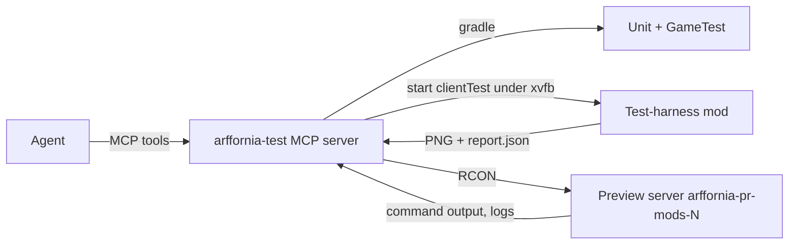

# 004 · In-game end-to-end testing for agents

!!! info "Status: research spec"
    Facts here were checked on the web on 2026-10-29 (links inline). Nothing is decided.
    Choices for the maintainer are listed in [Open questions](#open-questions-for-the-maintainer).

## Summary

Goal: an agent implements a feature, proves it works **in game** (logic, screens in English and
French, several GUI scales), and only then asks for review. Several features run at the same
time, each on its own server ([ADR-0007](../decisions/0007-preview-environments.md)).

Findings in one line each:

- **Server logic**: the NeoForge GameTest server already runs headless in the mod's CI
  (`runGameTestServer`, `gametest.yml`). It is the backbone. Keep growing it.
- **Client and UI**: NeoForge 1.21.1 still has **no official client test framework**. Fabric has
  one since 1.21.4; an unofficial NeoForge port exists but targets 26.1 only.
- **Best fit for 1.21.1**: a small **dev-only test-harness mod** in the Arffornia repo, run in a
  `clientTest` run under `xvfb-run` with Mesa llvmpipe. It opens screens, asserts widget state,
  switches language and GUI scale, and writes screenshots. If we adopt LDLib2 for GUIs
  ([spec 006](006-gui-design-system.md)), its UI test harness covers most of this already.
- **HeadlessMC** (MIT, NeoForge 1.21 supported) is useful as the *launcher* and gives a few
  runtime commands (list GUI elements, click, screenshot, connect to a server). It is good for
  "connect to the preview server and look"; it is not a test framework.
- **Mineflayer bots** do not speak the NeoForge handshake. They are not an option for a
  modded server that registers its own blocks and items.
- **Agent control** goes through RCON (server) and a localhost control port in the harness
  (client), both wrapped by one small MCP server.

## What exists today

| Piece | State | Evidence |
|---|---|---|
| GameTest suite | Being added: `ArfforniaGameTests`, in-memory `ProgressionBackend` (`-Darffornia.backend=fake`) | `Arffornia_Mods` branch `test/gametest-suite`, `src/main/java/.../gametest/ArfforniaGameTests.java` |
| GameTest CI | `gametest.yml` runs `./gradlew runGameTestServer` on PR and push | `Arffornia_Mods/.github/workflows/gametest.yml` |
| Client run | `client` run with fixed `--username` and `--uuid` | `Arffornia_Mods/build.gradle:89-95` |
| Screens | `CrafterScreen` (347 lines), `ProgressionGraphScreen` (1027), `SpaceElevatorScreen` (116) | `client/screen/*.java` |
| Translations | `en_us.json` only, 24 `Component.literal` calls in the three client screens | `assets/arffornia/lang/`, `client/screen/*.java` |
| Preview servers | Designed, not built | [Preview environments](../architecture/previews.md) |

## Options compared

### Server-side logic

| Option | What it tests | Headless CI | Maturity for NeoForge 1.21.1 | Verdict |
|---|---|---|---|---|
| **NeoForge GameTest server** ([docs](https://docs.neoforged.net/docs/1.21.1/misc/gametest)) | Blocks, block entities, menus server-side, packets handlers, recipes | Yes, exit code = failed required tests | Official, in use in the repo | **Keep, primary** |
| JUnit with `junit-fml` (MDG `unitTest`) | Codecs, maths, DTO parsing, lang-key lint | Yes, seconds | Official | **Keep, cheapest layer** |
| [mc-server-test](https://codeberg.org/headlesshq/mc-server-test) (HeadlessMC) | Production server boots with the jar; scripted commands from a JSON file | Yes | Supports NeoForge; its README says GameTest support is still a TODO | Optional smoke test on the *pack* |
| RCON scripts on a preview server | Real pack, real config, `/gametest runall`, custom `/arffornia` commands | Yes (in-cluster Job) | Planned in ADR-0007 | **Yes, for previews** |

### Client and UI

| Option | How it works | NeoForge 1.21.1 | Headless (no GPU) | Agent can drive it | Verdict |
|---|---|---|---|---|---|
| **Dev-only test-harness mod** (ours) | Extra source set loaded only in a `clientTest` run. Opens screens directly or via a fake menu, reads widget tree, sets language and GUI scale, saves framebuffer PNGs, exits with a code | Yes (plain NeoForge APIs) | `xvfb-run` + Mesa llvmpipe | Yes: scenario files + localhost port | **Recommended** |
| [LDLib2 UI Test Harness](https://low-drag-mc.github.io/LowDragMC-Doc/en/ldlib2/ui/testing/) | Java `UIScenario` classes (dev-only registration): `useBlock`, `awaitScreen`, `click`, `typeInto`, `checkText`, `checkBounds`, `screenshot`; reports in `build/ldlib2-uitest/`; parallel and multiplayer runs | Yes (LDLib2 2.2.44 for 1.21.1, Oct 2026) | Has a headless flag; screenshots read the main framebuffer; pins window size and GUI scale | Yes | **Recommended if we adopt LDLib2** (spec 006). Scripts target NeoGradle, must be ported to ModDevGradle |
| [neoforge-client-gametest-api](https://github.com/Wurst-Imperium/neoforge-client-gametest-api) (unofficial port of Fabric's API) | Fabric-style `ClientGameTestContext`: world builder, screenshots | **No**: plugin version `0.1.0+26.1.2`, uses NeoGradle, 4 commits, no release | Fabric docs describe `useXVFB` | Yes | Watch; reuse its ideas, not the jar |
| [Fabric Client GameTest API](https://docs.fabricmc.net/develop/automatic-testing) | Reference design (screenshots, world builder, CI with xvfb) | Fabric only | Yes | Yes | Design reference only |
| [HeadlessMC](https://github.com/headlesshq/headlessmc) + [hmc-specifics](https://github.com/headlesshq/hmc-specifics) | CLI launcher (MIT). `-lwjgl` patches LWJGL to render nothing. hmc-specifics adds runtime commands: `gui` (list elements), `click`, `text`, `render` (dump drawn strings), `screenshot` (only when really rendering), `connect`, `/` (chat command) | Yes (1.21–1.21.11 NeoForge) | `-lwjgl` = no pixels; with Xvfb = real pixels | Yes, via stdin commands | **Use as launcher** for "join the preview server" checks |
| [mc-runtime-test](https://github.com/headlesshq/mc-runtime-test) (GitHub Action) | Boots a production client, joins a world, runs `/test runall`, quits | Yes | Xvfb input | Low (pass/fail only) | Nice smoke test; its README says GameTest discovery on NeoForge in production needs manual registration |
| [AutoMine Testing](https://github.com/ashleywr/automine-testing) | Dev-only client helper: localhost HTTP, screen inspect/click, screenshots | Has a NeoForge 1.21.1 build | Not documented | Yes | Too new (0 stars, 2 commits); good proof the design works |
| [Mineflayer](https://github.com/PrismarineJS/mineflayer) bots | Node bot speaking the vanilla protocol (1.8 to 26.1) | **No** for our server: no NeoForge negotiation. A client without the mod's registries cannot join a server that adds items ([NeoForge #3481](https://github.com/neoforged/NeoForge/issues/3481) shows even the vanilla case is a bug path). The Forge plugin [minecraft-protocol-forge](https://npmjs.com/package/minecraft-protocol-forge) is from 2022 and pre-NeoForge | n/a (no rendering) | Yes | **Reject** for modded E2E |
| Pixel-level desktop automation (xdotool, VNC) | Click coordinates on the real window | Yes | Yes | Fragile | Reject |

### Screenshot comparison (EN/FR, GUI scales)

| Check | How | Catches |
|---|---|---|
| **Text fits** (primary, no images) | The harness walks every widget and label, measures `font.width(component)` against the widget's box for each locale and scale | French strings ~20% longer overflowing buttons and labels |
| **Missing keys** | Harness fails if any rendered string equals its translation key (`gui.arffornia.*`); unit test checks every key exists in `en_us` and `fr_fr` | Raw keys, missing French |
| Golden images | [pixelmatch](https://github.com/mapbox/pixelmatch) (ISC, v8.0.0 Oct 2026) or [odiff](https://github.com/dmtrkovalenko/odiff) (MIT) against approved PNGs, with a tolerance | Layout regressions |
| Contact sheet | Stitch `{screen} × {en_us, fr_fr} × {scale 2, 3, 4}` into one PNG attached to the PR | Lets the maintainer review in 10 seconds |

Golden images are brittle across Mesa versions and font changes. Use them only for a few
key screens, pin the CI image, and treat the *text-fits* check as the gate.

## Headless CI feasibility

| Topic | Finding |
|---|---|
| Rendering without GPU | Minecraft 1.21 needs OpenGL 3.2 core. Mesa llvmpipe provides it in software under Xvfb (`LIBGL_ALWAYS_SOFTWARE=1`). The docs repo already renders draw.io this way. |
| Early loading window | LDLib2's docs note that in headless runs the FML early window is disabled when no display is found, and that this can drop the context to OpenGL 3.2 core. Set `fml.earlyWindowControl=false` in the test run. |
| Speed | Expect a few FPS with llvmpipe. Fine for opening screens and taking stills; not for gameplay. Use small windows (e.g. 1280×720) and render distance 2. |
| Verify the renderer | Log `GL_RENDERER` at start and fail the job if it is not `llvmpipe`; silent fallbacks are a known trap ([microlink write-up](https://microlink.io/blog/webgl-without-a-gpu)). |
| Assets | Client runs download vanilla assets once; cache `~/.gradle` and the MDG assets folder. |
| Network | Integrated server in the same JVM; no external server needed for screen tests. |

### Runtimes and costs

GitHub-hosted standard Linux runners are **$0.006/min** (2-core) per
[GitHub pricing](https://docs.github.com/en/enterprise-cloud@latest/billing/reference/actions-runner-pricing);
public repositories normally get standard runners free. Estimates below are from the current
GameTest job and typical NeoForge dev-client boots; measure in the pilot.

| Job | Trigger | Est. wall time | Est. cost per run (private) |
|---|---|---|---|
| Unit + lang lint | every PR | 3–4 min | ~$0.02 |
| GameTest server | every PR | 8–10 min | ~$0.06 |
| Client harness (3 screens × 2 locales × 3 scales) | PR label `ui` + nightly | 12–18 min | ~$0.10 |
| Preview server + RCON Job | PR label `preview` | 5–10 min to Healthy (300-mod pack) | cluster time, not Actions |

A self-hosted runner in the cluster removes the Actions cost but runs arbitrary PR code; only
use it for same-repo, label-gated PRs (same rule as previews).

## How an agent drives it

One small MCP server (stdio, TypeScript or Java), living in the mod repo under `tools/`,
exposes a handful of tools. Existing RCON MCP servers (for example
[minecraft-rcon-mcp](https://awesome.ecosyste.ms/projects/github.com%2Fdeemkeen%2Fminecraft-rcon-mcp),
one `sendCommand` tool, 0 stars) show the idea but are too thin to depend on.

| Tool | Does |
|---|---|
| `run_gametests(filter?)` | `./gradlew runGameTestServer`, returns JUnit summary |
| `run_ui_scenarios(names, locales, scales)` | Starts the harness, returns `report.json` and screenshot paths |
| `screenshot_screen(screen, locale, scale)` | One still, for iteration |
| `rcon(server, command)` | Allow-listed commands only (`/gametest`, `/arffornia`, `/give` to the test player, `/tp`, `/setblock`) |
| `server_logs(server, since)` | Tail `latest.log`, grep `ERROR` and mixin failures |

Rules: the MCP never gets cluster credentials; preview servers are reached through the
read-only paths of ADR-0007. RCON passwords for previews are generated in-namespace.

## Recommendation

1. **Now**: keep GameTests as the gate on every PR. Add the lang lint unit test.
2. **Next**: build the **dev-only test-harness mod** (own source set, never in the release jar),
   with a scenario format agents can write, the *text-fits* check, and the contact sheet. If
   spec 006 adopts LDLib2, use **LDLib2's harness** for LDLib2 screens instead of writing our own
   widget walker, and keep our harness thin (world setup, locale, scale, exit code).
3. **Then**: the MCP wrapper, then RCON tests on preview servers once ADR-0007 lands.
4. **Do not** invest in Mineflayer or pixel-coordinate automation.

## Pilot plan

Pilot screen: **Crafter** (`CrafterScreen`): it has a menu, energy bar, recipe list and the
player inventory, so it covers most widget types.

| Step | Done when |
|---|---|
| 1. `clientTest` run in `build.gradle` with `-Darffornia.backend=fake`, `-Darffornia.testharness=true`, fixed window 1280×720 | `./gradlew runClientTest` boots under `xvfb-run` and exits 0 |
| 2. Harness creates a flat test world, places a Crafter with energy, opens its menu | Screenshot `crafter.en_us.gui2.png` written |
| 3. Locale loop `en_us`, `fr_fr`; scale loop 2, 3, 4 | 6 PNGs + a contact sheet |
| 4. Checks: no raw keys, every label fits its box, recipe count matches the fake backend | Report fails when a French string is made too long on purpose |
| 5. CI job `ui-tests.yml` on label `ui` + nightly, uploads the contact sheet | Artifact visible on a PR |

Expected effort: about 4–6 agent days.

## Work breakdown

| # | Title | Acceptance criteria | Effort |
|---|---|---|---|
| 1 | Add lang-key lint test (en_us/fr_fr parity, no unused keys) | Unit test fails on a missing `fr_fr` key; runs in `make check` | S |
| 2 | Add `clientTest` run and `testharness` source set (dev-only) | Release jar contains no harness classes (checked in CI); run boots under `xvfb-run` | M |
| 3 | Harness: world bootstrap and screen opener | Opens Crafter, Space Elevator and Progression screens against the fake backend; exit code reflects failures | M |
| 4 | Harness: locale and GUI-scale loop with screenshots | PNGs named `<screen>.<locale>.gui<N>.png` under `build/ui-tests/`; `GL_RENDERER` logged and asserted | S |
| 5 | Harness: text-fits and raw-key checks | Fails on overflow or on a string equal to its key; report lists widget, locale, scale, overflow px | M |
| 6 | Contact sheet + `ui-tests.yml` workflow | One PNG per run attached as artifact; job on label `ui` and nightly | S |
| 7 | `arffornia-test` MCP server (gradle + harness tools) | Agent can run scenarios and get report paths; documented in `AGENTS.md` | M |
| 8 | RCON tools for preview servers (allow-list) | Non-allow-listed commands refused; works against one preview namespace | M (after ADR-0007) |
| 9 | Golden-image check for 2 key screens | pixelmatch with tolerance; update script for approved changes | S |
| 10 | Optional: mc-runtime-test smoke job for the full pack | Production client joins a world with the pack and exits 0 | S |

## Open questions for the maintainer

1. Is a **dev-only harness source set** in `Arffornia_Mods` acceptable (never shipped), or do you
   want it in a separate repo?
2. Should UI tests run on **every PR** (slower, ~15 min) or only on label `ui` plus nightly?
3. Are the repos staying **public** (free standard runners) or will some go private?
4. May a **self-hosted runner** in the cluster run label-gated PR builds?
5. Golden images: which screens are worth pinning pixel-for-pixel, if any?
6. Depends on spec 006: do we adopt LDLib2 (and its test harness)?
