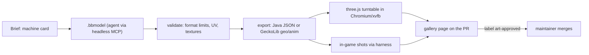

# 005 · 3D model pipeline for machines and multiblocks

!!! info "Status: research spec"
    Facts checked on the web on 2026-10-29 (links inline). Nothing is decided. Choices for the
    maintainer are in [Open questions](#open-questions-for-the-maintainer).

## Summary

Goal: agents produce block, machine and multiblock models with a futuristic, Satisfactory-like
look, check them, and show them for approval, with as little human modelling as possible.

- **Source of truth: Blockbench `.bbmodel`** files in the mod repo. Every export (Java block
  JSON, GeckoLib geo + animation) is generated from them and checked in CI.
- **Headless editing now exists.** The
  [Blockbench MCP project](https://github.com/jasonjgardner/blockbench-mcp-plugin) (GPL-3.0)
  ships a **headless stdio MCP server** that creates, edits, validates, exports
  (`bbmodel_export_java_block`, Bedrock/GeckoLib geometry and animations) and renders `.bbmodel`
  files without Blockbench running, with per-file revision locks so agents can work in
  parallel. It is the most direct fit; its renderer needs a GPU (WebGPU via Dawn), so our CI
  renders previews another way.
- **Two model tiers**: static machines as **Java block models** (cheap, no dependency, 3×3×3
  block limit, one-axis 22.5° rotations); animated machines and multiblock "cores" as
  **GeckoLib** models (MIT, NeoForge 1.21.1 build 4.9.3, Sept 2026).
- **Previews headless**: render in Chromium with three.js under Xvfb + llvmpipe for fast
  turntables, and the **in-game harness** from [spec 004](004-in-game-e2e-testing.md) for the
  final truth (lighting, culling, GUI icons).
- **Approval**: a generated **gallery page** per PR (turntable PNGs, texture sheets, in-game
  shot) that the maintainer approves with a label.
- **Licensing**: original or CC0 textures only, provenance recorded per asset; no Mojang
  textures copied; AI-generated textures carry weak copyright, so the human-selected and
  edited result is what we own.

## Current state

| Item | Finding | Evidence |
|---|---|---|
| Models | `crafter_block.json`, `space_elevator.json`: hand-made in Blockbench ("Made by Thysma_28"), Java block format | `Arffornia_Mods/src/main/resources/assets/arffornia/models/block/` |
| Defects | 3 faces each reference `#missing` (purple-black texture) | `grep '#missing' models/block/*.json` |
| Textures | 16×16 PNGs, 6 per machine (`texture2..5`, `n_s_texture`, `g_d_texture`) | `textures/block/crafter_block/` |
| Multiblocks | Two-block structures today; a 3×3×3 framework is a P3 ticket needing a decision | mod-proxy audit §9, Q4 |
| Animation | None, no GeckoLib dependency | `build.gradle` |

## Formats

| Format | Use for | Limits | Runtime cost | Source |
|---|---|---|---|---|
| **Java block/item model JSON** | Static machines, casings, parts, items | Cube elements only; coords -16..32 (keep 0..16 for lighting/culling); one rotation axis, ±45° in 22.5° steps; ≤3×3×3 blocks; texture animation only | Baked, free | [NeoForge model docs](https://docs.neoforged.net/docs/1.21.1/resources/client/models/), [Blockbench formats](https://www.blockbench.net/wiki/blockbench/formats) |
| NeoForge loaders: `composite`, `obj`, `elements` | Multi-part static models, OBJ meshes | OBJ needs `.mtl`; composite parts toggled by child models | Baked | [Model loaders](https://docs.neoforged.net/docs/1.21.1/resources/client/models/modelloaders) |
| **GeckoLib** (Bedrock `.geo.json` + `.animation.json`) | Animated machines (fans, pistons, glowing cores), large multiblock controllers | Rendered by a BlockEntityRenderer: costs per frame; block needs `RenderShape.ENTITYBLOCK_ANIMATED` | Per-frame BER | [GeckoLib blocks wiki](https://github.com/bernie-g/geckolib/wiki/Geckolib-Blocks-(Geckolib4)), [Modrinth 4.9.3](https://modrinth.com/mod/geckolib) |
| AzureLib | GeckoLib fork, same model files | Same as GeckoLib | Per-frame BER | [Modrinth](https://modrinth.com/mod/azurelib) (MIT, 3.2.2 Oct 2026) |
| Hand-written BER | Rotating shafts, item-in-machine | Code, not assets | Per-frame | NeoForge docs |

Rule of thumb: **baked JSON for anything that does not move**; GeckoLib only for the one moving
part, layered on a baked casing, to keep FPS when players build dozens of machines.

## Options compared

### Authoring and editing

| Option | Headless | Parallel agents | Validates | Exports | Licence / maturity | Verdict |
|---|---|---|---|---|---|---|
| **Blockbench MCP – headless mode** ([README](https://github.com/jasonjgardner/blockbench-mcp-plugin/blob/main/headless/README.md)) | Yes (stdio, Node or Bun) | Yes: revision check + lock file per model | Format limits on every edit (Java block bounds, rotations), slivers, floating parts, overlaps, symmetry, GeckoLib rules; animation sanity | Java block JSON, Bedrock/GeckoLib geo + animation, modded entity | GPL-3.0; repo ~540 stars; skill listed April 2026 | **Primary tool for agents.** Run as a dev tool, never ship its code |
| Blockbench MCP – desktop plugin | No (needs Blockbench desktop) | One project at a time | Blockbench's own | All Blockbench formats | Same | For the maintainer's manual touch-ups |
| Generate model JSON programmatically (our own generator in Java datagen or a script) | Yes | Yes | Only what we write | Java block JSON | Ours | Good for **parametric parts** (pipes, casings, connectors) |
| Blockbench CLI | Does not exist; maintainer pointed to third-party converters ([issue #1764](https://github.com/JannisX11/blockbench/issues/1764)) | — | — | — | — | No |
| [bbconv](https://awesome.ecosyste.ms/projects/github.com%2Fsolid-resourcepack%2Fbbconv) (Go) | Yes | Yes | No | Resource-pack files | MIT, last push March 2025 | Not needed |
| Blender + OBJ loader | Partly (Blender runs headless) | Yes | No Minecraft rules | OBJ | Mature | Off-style for pixel-art blocks; avoid |

### Preview rendering (headless, no GPU)

| Option | Fidelity | Speed on llvmpipe | Effort | Verdict |
|---|---|---|---|---|
| Blockbench MCP `bbmodel_render` / `bbmodel_contact_sheet` | Blockbench look | **Needs a GPU** (WebGPU via Dawn, Node ≥ 23.6) | None | Use on a dev machine with GPU; not in CI |
| **three.js page in Chromium (Playwright) under Xvfb** with [three-blockbench](https://github.com/Hoodgail/three-blockbench) or our own Java-model loader | Close (no MC lighting) | Seconds per frame with `--use-angle=gl` + llvmpipe ([findings](https://microlink.io/blog/webgl-without-a-gpu)) | M | **CI turntables** |
| [deepslate](https://github.com/misode/deepslate) (MIT, 0.27.2 Sept 2026) | Minecraft-like block model rendering in WebGL | Same as above | S–M | Good alternative for Java block models |
| **In-game screenshot via test harness** (spec 004) | Exact | Slow but fine for stills | Reuses harness | **Final check** (in world, in GUI, in hand) |

### Textures

| Option | Notes | Verdict |
|---|---|---|
| Agent writes pixel art programmatically (palette + shapes + noise, PNG via code) | Deterministic, reviewable, matches a fixed palette | **Default** for panels, casings, glow strips |
| Image models (e.g. pixel-art generators such as [PixelLab](https://www.pixellab.ai/llms-full.txt)) | Fast ideas; check each service's commercial terms; output must be palette-quantised and cleaned | Optional, maintainer opt-in |
| Human artist | Best quality | For hero machines |

Texture rules checked in CI: power-of-two sizes (16, 32, 64), same texel density per model
(16 px per block face unless agreed), palette from the design tokens
([spec 006](006-gui-design-system.md)), emissive parts on a separate texture or `_e` layer,
`.mcmeta` for animated textures valid, no `#missing`, every referenced texture exists.

## Licensing

| Topic | Rule |
|---|---|
| Mojang assets | The [usage guidelines](https://www.minecraft.net/en-us/usage-guidelines) allow mods that do not contain a substantial part of Mojang content. Do not copy vanilla textures into the repo; reference `minecraft:` textures by id if needed. |
| Third-party assets | Only CC0 or explicitly compatible licences; record source URL and licence in `assets/arffornia/CREDITS.md` (or a per-folder `LICENSE.txt`). |
| AI-generated textures | The US Copyright Office says prompt-only output is generally not protected; human selection, arrangement and editing can be ([summary](https://datamatters.sidley.com/2025/02/07/u-s-copyright-office-issues-report-on-artificial-intelligence-and-copyrightability/)). Keep the human approval step and record `ai_used: true` (the headless MCP writes `ai_used`/`ai_agents` fields into `.bbmodel` by default). |
| Tool licences | Blockbench MCP is GPL-3.0: use it as an external tool; do not vendor its code into the mod. GeckoLib is MIT. |
| Mod licence | The mod is "All Rights Reserved" today (`gradle.properties`); the asset licence must be decided with it. |

## Recommended pipeline

1. **Brief**: a short "machine card" in the issue: name, footprint (1×1, 2×1, 3×3×3), IO faces,
   animated parts, palette, reference images.
2. **Model**: the agent edits `models/src/<machine>.bbmodel` through the headless MCP, starting
   from shared kit parts (frame, panel, vent, pipe port, screen, glow strip).
3. **Validate**: `bbmodel_validate` plus our checks (texture sizes, palette, no `#missing`,
   texture references resolve, Java-format limits).
4. **Export**: generated files go to `src/main/resources/assets/arffornia/{models,geo,animations}`;
   CI regenerates and fails on diff (same pattern as datagen).
5. **Render**: turntable (4 angles + top) and texture sheet in CI; in-game shots (placed, in
   inventory, in the machine GUI) via the harness.
6. **Approve**: CI publishes a gallery (PR artifact, or a page on the docs site per PR). The
   maintainer adds `art-approved`; without it, the PR is not ready.

### Style kit (Satisfactory-like)

A shared, versioned kit makes agent output consistent: industrial frame, orange/charcoal
panels, hazard stripes, cyan/amber emissive indicators, bolted plates, round pipe ports, a
status screen face. Colours come from the shared tokens in spec 006. The kit lives in
`models/kit/*.bbmodel` and textures in `textures/block/kit/`.

## Pilot

Machine: **re-model the Crafter** (exists, has a GUI and recipes, 2 blocks tall today).

| Step | Done when |
|---|---|
| 1. Import current `crafter_block.json` into `.bbmodel` (`bbmodel_import_java_block`) and fix the 3 `#missing` faces | Validation clean; in-game shot shows no purple-black faces |
| 2. Build the kit (frame, panel, vent, port, screen, glow) | Kit renders in a contact sheet |
| 3. New Crafter v2 from the kit, static Java JSON | Within Java limits; ≤ 64×64 textures; palette check passes |
| 4. Optional animated variant with GeckoLib (spinning fan, pulsing core when crafting) | Animation validates; BER only on the animated part |
| 5. Gallery on the PR (turntable + in-game + GUI icon) | Maintainer can approve with one label |

Expected effort: 4–7 agent days, plus maintainer review rounds.

## Work breakdown

| # | Title | Acceptance criteria | Effort |
|---|---|---|---|
| 1 | Fix `#missing` faces on Crafter and Space Elevator models | No `#missing` in any model; test fails if one reappears | S |
| 2 | Add model/texture lint (sizes, references, palette, Java limits) | Unit test or script in `make check`; fails on a 17×16 texture or a dangling texture ref | S |
| 3 | Set up headless Blockbench MCP for agents (pinned commit) and document it in `AGENTS.md` | Agent can create, validate and export a cube model; GPL tool not vendored | S |
| 4 | Store `.bbmodel` sources and add export-diff CI | `models/src/*.bbmodel` → generated JSON; CI fails when exports are stale | M |
| 5 | Headless turntable renderer (Playwright + three.js/deepslate, xvfb + llvmpipe) | 5 PNGs per model in < 1 min on a 2-core runner; asserts `llvmpipe` renderer | M |
| 6 | PR gallery artifact (turntable + texture sheet + in-game shots) | One HTML/PNG artifact per PR; linked in a PR comment | M |
| 7 | Style kit v1 (models + textures + palette from tokens) | 6 kit parts; contact sheet approved by maintainer | M |
| 8 | Crafter v2 model (pilot) | Approved with `art-approved`; in-game shots in EN/FR GUIs | M |
| 9 | Add GeckoLib dependency and one animated part | Animated Crafter variant renders; FPS check with 50 machines in view documented | M |
| 10 | Asset provenance file and licence decision | `CREDITS.md` lists every non-original asset; licence chosen | S (needs decision) |

## Open questions for the maintainer

1. **Art direction**: OK with a Satisfactory-like kit (orange/charcoal, cyan/amber glow)? Any
   reference packs or mods you want it close to, or far from?
2. **Texture resolution**: stay at 16×16 per block face (vanilla look) or go 32×32 for machines?
3. **GeckoLib**: acceptable as a required dependency of the mod (clients must have it)?
4. **AI-generated textures**: allowed, allowed with disclosure, or not allowed?
5. **Asset licence**: the mod is "All Rights Reserved"; should assets be the same, or CC BY-NC?
6. Is **Thysma_28** (author of the current models) still involved, and should their models be
   kept as the base?
7. Multiblocks (mod audit Q4): which first multiblock should validate the framework?
