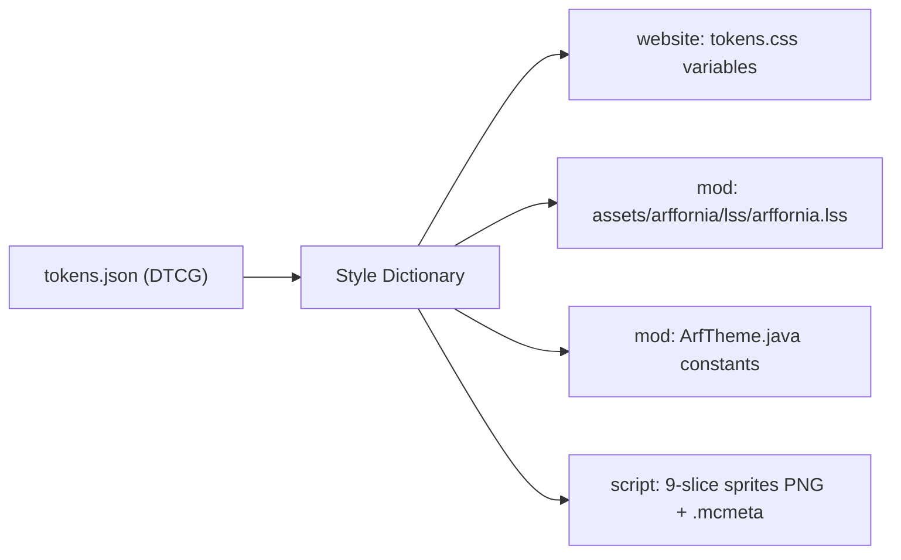

# 006 · GUI design system for in-game screens

!!! info "Status: research spec"
    Facts checked on the web on 2026-10-29 (links inline). Nothing is decided. Choices for the
    maintainer are in [Open questions](#open-questions-for-the-maintainer).

## Summary

Goal: polished in-game GUIs (Paladium-level), themed like the website, **with no text baked
into textures**: every visible string is translatable (EN and FR now, more later). GUIs are
generated and styled from data, not hand-painted PNGs. Agents must verify screens themselves in
every language and GUI scale.

- **Recommended: a hybrid, native-first approach.**
    - **Machine and inventory screens** (Crafter, Space Elevator, future machines) stay
      **native** `AbstractContainerScreen` + `Menu`, because item slots, shift-click and server
      sync live there.
    - Build them with **[LDLib2](https://github.com/Low-Drag-MC/LDLib2)** (LGPL-3.0, NeoForge
      1.21.1 build 2.2.44, Oct 2026). It is the closest thing to "web-like" that is still
      native: XML layouts, CSS-like **LSS** stylesheets, flexbox/grid layout, data bindings for
      menus, SDF fonts, and its own **UI test harness** with screenshots. Pilot it on the
      Crafter. If it fails the pilot, fall back to a small in-house widget kit on vanilla
      `GuiGraphics`.
    - **One token file** (colours, type scale, spacing, radii) generates the website CSS
      variables, the LDLib2 stylesheet, a Java constants class and any 9-slice sprites.
- **Web layer (embedded Chromium) only later and only for "web pages in game"** (shop, ranking,
  news), not for machines. Paladium's modded network is publicly reported to use MCEF for
  custom menus; it works, but it costs a ~150 MB Chromium download, extra memory, and a second
  i18n and auth path.
- **i18n pipeline**: keys `gui.arffornia.<screen>.<element>`, `en_us.json` is the source,
  `fr_fr.json` must have every key (CI lint), a pseudo-locale for "+30% and accents" tests, and
  a **text-fits check** in the test harness so French never overflows.

## Current state

| Item | Finding | Evidence |
|---|---|---|
| Screens | `CrafterScreen`, `ProgressionGraphScreen`, `SpaceElevatorScreen`: vanilla `blit` of fixed 176×166 PNG backgrounds at fixed offsets | `client/screen/CrafterScreen.java:148-157` |
| GUI textures | `crafter_gui.png`, `space_elevator_gui.png` (176×166), `node_background.png` (600×600), `energy_bar.png`, `progress_arrow.png`, icons | `assets/arffornia/textures/gui/` |
| Text | 24 `Component.literal` calls in the three screens; `en_us.json` only, no `fr_fr.json`; missing keys `gui.arffornia.reset_view`, `gui.arffornia.search_hint` | mod-proxy audit §5.4, §8 |
| Theme | None in the mod. Website uses orange `#ff7300` (33 uses), dark `#09070a` / `#261d31`, Montserrat | `Arffornia_Website/public/css/**` |
| Rule | Player-facing text through i18n with `en` and `fr` | [ADR-0002](../decisions/0002-english-codebase-bilingual-players.md) |

Whether the current PNG backgrounds contain painted text must be checked (task 1 below).

## What Paladium is known to use

| Claim | Source | Confidence |
|---|---|---|
| Paladium's **launcher** is built with Vue.js and Electron | [Launcher developer's portfolio](https://gaetan.dezeiraud.com/softwares/paladium/) | Public, first-hand |
| On **"Modded"**, Paladium's network of modded servers, **MCEF** was used to replace Minecraft's native menus with custom interfaces, with TypeScript ↔ Java communication | [Former Lead Web Developer's portfolio](https://mathislebonniec.fr/projects/paladium) | Public, first-hand, short |
| What the **main Paladium server's** in-game GUIs use | No public source found | **Unknown** |

So "works like the web" is plausible for at least part of Paladium (Chromium in game). It is
not documented beyond these portfolios; do not assume more.

## Options compared

### UI technology

| Option | Kind | NeoForge 1.21.1 | Maintained | Licence | Menus / item slots | Fonts and French | GUI scale | i18n with lang files | Perf / memory | Headless screenshot tests |
|---|---|---|---|---|---|---|---|---|---|---|
| **Vanilla** `Screen` / `AbstractContainerScreen` + own widgets ([docs](https://docs.neoforged.net/docs/1.21.1/gui/screens)) | Native, code | Yes | Mojang/NeoForge | — | Native | Vanilla font has accented Latin glyphs + Unifont fallback; TTF via font JSON | Integer GUI scale; must lay out relative to `width`/`height` | `Component.translatable` | Best | Our harness (spec 004) |
| **LDLib2** ([docs](https://low-drag-mc.github.io/LowDragMC-Doc/en/ldlib2/)) | Native, **XML + LSS (CSS-like) + flex/grid**, Java/Kotlin builders, optional Compose | Yes, 2.2.44 (24 Oct 2026) | Very active | LGPL-3.0 | Yes: `ModularUI` menu UIs, two-way data bindings (`DataBindingBuilder`), `ItemSlot`, `InventorySlots`, `FluidSlot`, JEI/EMI support | Own font pipeline (SDF/raster), falls back to MC Unicode font | Renders in GUI-scaled viewport; harness pins scale | Text "translated via `LocalizationUtils`"; confirm `Component.translatable` in pilot | Native; heavier than vanilla | **Built-in UI Test Harness**: `checkText`, `checkBounds`, `screenshot`, headless flag, parallel shards |
| **ModernUI** ([repo](https://github.com/BloCamLimb/ModernUI-MC)) | Native framework (Android-like views) + text engine | Yes, but 1.21–1.21.1 marked **Legacy** (3.13.0.1, June 2026); mainline is 26.1 | Yes, on 26.x | LGPL-3.0+ | Hybrid with vanilla GUIs | Best text engine: TTF/OTF, Unicode line breaking, bidi, SDF | Own | Uses Components | Native | None built in |
| **owo-ui** ([owo-lib](https://modrinth.com/mod/owo-lib)) | Native, XML + code | NeoForge **beta** (`0.12.15.6-beta.1+1.21`, Oct 2026) | Fabric-first | MIT | Yes | Vanilla | Own | Yes | Native | None |
| **ApricityUI** ([Modrinth](https://modrinth.com/mod/apricityui), [repo](https://github.com/Tower-of-Sighs/AUI)) | Native **HTML + CSS** renderer written in Java; JS only with KubeJS | Listed (1.2.9, 26 Oct 2026) | Active, young (~8 months) | LGPL-2.1 | Container slots in HTML | Not documented | Not documented | "Translation keys as native elements" | Native; author asks for stutter reports | None documented |
| **TesseraUI** ([Modrinth](https://modrinth.com/mod/tesseraui)) | Native, HTML/CSS-style templates, flex/grid, CSS variables, data binding | Yes (1.1, May 2026) | Small (≈400 downloads) | LGPL-3.0 | Not documented | Vanilla | Not documented | Not documented | Native | None |
| **MCEF / Rinku** (Chromium Embedded) ([MCEF](https://github.com/CinemaMod/mcef), [Rinku fork](https://github.com/Keksuccino/mcef/)) | Real browser, off-screen rendered to a texture | MCEF 2.1.6 (Oct 2024, Chromium 116); **Rinku 3.0.4** (Aug 2026, Chromium 151) | Rinku active | MCEF LGPL; Rinku licence not stated on README | **No slots**: menus must stay native or be bridged by packets | Full web fonts, perfect accents | Browser zoom; map to MC GUI scale manually | Separate web i18n, or pass MC locale + strings to the page | Extra Chromium processes; first-launch download ~150 MB (per WebGUI README) | Possible under Xvfb, but CEF on llvmpipe is unproven: pilot needed |
| **WebGUI** ([repo](https://github.com/mc-webgui/webgui)) on Rinku | Ready-made full-screen web GUI / HUD; pushes client data to the page; **HMAC-signed player token** for your backend; mod API | Yes (2.0.0, Oct 2026) | Active | MIT | No slots | Web | Web | Web-side | As MCEF | As MCEF |
| **Ultralight** (HTML renderer SDK) ([pricing](https://ultralig.ht/pricing)) | Lightweight HTML/CSS engine, CPU or GPU renderer | **No maintained NeoForge 1.21.1 mod found**; Java bindings exist ([ultralight-java](https://github.com/LabyMod/ultralight-java)), older Forge 1.8.9 ports | SDK yes | **Proprietary**; free tier only under $200K turnover *and* funding; free SDK caps 60 FPS, no JS JIT | No slots | Web | Web | Web-side | Lighter than CEF | Unproven |

### Approaches

| Approach | Polish | Text never in PNG | Menus/slots | Agent-friendly | Risk |
|---|---|---|---|---|---|
| A. Vanilla + own widget kit + tokens | Good with effort | Yes | Native | Medium: agents write Java layout code | We maintain the kit |
| **B. LDLib2 (XML + LSS) + tokens** | High | Yes | Native, bound | **High**: XML/LSS are text, schema (`ldlib2-ui.xsd`) and an official agent guide exist | Dependency on one library; LGPL; NeoGradle-oriented test scripts |
| C. Full web layer (Rinku/WebGUI) for all screens | Highest for rich pages | Yes | **No** (machines need native slots anyway) | High for HTML devs | Download size, memory, Linux/macOS issues, two auth paths, harder CI |
| **D. Hybrid: B for machines + web layer later for shop/ranking/news** | High | Yes | Native where needed | High | Web part is optional and deferred |

## Recommendation

**Approach D, starting with B only.**

1. **Machines and inventories**: LDLib2 `ModularUI` screens defined in XML, styled by a
   generated LSS theme, data-bound to the menu. No painted panels: backgrounds are drawn from
   tokens (rects, SDF rounded rects, borders, gradients) plus a small set of icon sprites and
   9-slice frames generated from tokens. Text always from lang keys.
2. **Fallback**: if the LDLib2 pilot fails (perf, i18n, build integration), build approach A:
   a thin kit (`ArfPanel`, `ArfButton`, `ArfLabel`, `ArfBar`, `ArfSlotFrame`) on vanilla
   `GuiGraphics` with `blitSprite` and `gui.scaling: nine_slice` sprites, reading the same tokens.
3. **Web layer later**, only for pages whose data already lives on the website (shop, ranking,
   news, profile). Use WebGUI on Rinku, with the signed token so the website knows the player.
   Decide after the launcher can **bundle Chromium** (no first-launch download) and after a CI
   screenshot test of CEF under Xvfb works.
4. Do not use Ultralight (licence, no maintained 1.21.1 integration). Do not use ModernUI as the
   framework (1.21.1 is legacy), but keep it compatible: LDLib2 falls back to the vanilla path
   when ModernUI is installed.

## Design tokens shared with the website

- Format: [Design Tokens Community Group](https://www.designtokens.org/) JSON, built with
  [Style Dictionary](https://styledictionary.com/) (v5.7.1, Oct 2026). Lives in the docs repo or
  a small `design-tokens` folder in the website repo (open question).
- Seed values from the website: `color.brand.primary = #ff7300`, `color.bg.base = #09070a`,
  `color.bg.raised = #261d31`, `font.heading = Montserrat` (OFL), plus status colours already
  used (`#27ae60` ok, `#c0392b` error, `#f39c12` warning, `#3498db` info).
- In game, colours map 1:1. Type maps to a **scale of pixel sizes** that are multiples of the
  vanilla 9 px line, not to web rem values.
- LDLib2 resource-pack override (`assets/<ns>/lss/<name>.lss`) lets a pack re-theme without code.

## Fonts, glyphs and GUI scale

| Topic | Finding | Rule |
|---|---|---|
| French glyphs | Vanilla's default font includes accented Latin bitmaps and a Unifont fallback, so é è à ç ô œ « » render. | Keep the vanilla font for body text; test `fr_fr` strings with `œ`, `É`, `«»`, non-breaking spaces before `:` `?` `!` |
| Custom fonts | Font JSON supports a `ttf` provider (size, oversample, shift); TTF looks blurry at non-integer scales. LDLib2 and ModernUI offer SDF text. | Montserrat (OFL) only for large headings, via SDF; never below 2× GUI scale |
| GUI scale | Integer scales 1–4+ (auto); NeoForge docs: always position relative to screen size and scale | Layout in flex/grid (LDLib2) or relative maths; test scales 2, 3, 4 and the smallest supported window (e.g. 854×480) |
| Text never in images | Required by the maintainer | Lint: run OCR (Tesseract) on `textures/gui/**` in CI and fail on words; review checklist item |

## i18n pipeline

| Step | Rule |
|---|---|
| Keys | `gui.arffornia.<screen>.<element>[.<state>]`, `tooltip.arffornia.*`, `message.arffornia.*`. No `Component.literal` for player text (lint). |
| Source | `en_us.json` is the source of truth; written by datagen (`LanguageProvider`) or by hand, not both. |
| French | `fr_fr.json` must contain every key (CI parity test). Agents add both in the same PR. |
| Fallback | Minecraft resolves a missing key from `en_us`, so a missing French key shows English, not a raw key; the lint still fails the PR. |
| Arguments | Use `%s` / `%1$s` placeholders; never build sentences by concatenation (word order differs in French). |
| Pseudo-locale | A dev-only locale in the test harness (`en_xx`): each string +30% longer, wrapped in `[ ]`, with accents (`Çràftér`). Overflow and concatenation bugs show up before any real translation. |
| Text measurement | Widgets size from text: `font.width(component)` + padding, wrap with `font.split(..)`, or ellipsis with full text in a tooltip. The harness *text-fits* check ([spec 004](004-in-game-e2e-testing.md)) fails if any string overflows its box in any locale and scale. |
| More languages | Adding `de_de` etc. = one JSON file + run the harness; nothing else changes. |

## How agents verify screens

Every GUI PR must attach, from CI or a local run of the harness:

- a contact sheet `{screen} × {en_us, fr_fr, en_xx} × {GUI scale 2, 3, 4}`;
- the harness report: no raw keys, no overflow, widgets present, values bound (e.g. energy bar
  matches the block entity);
- for LDLib2 screens, LDLib2 `UIScenario`s (`checkText`, `checkBounds`, `screenshot`).

## Pilot plan

Pilot: **Crafter screen** (menu, slots, energy bar, progress arrow, recipe list, search field).

| Step | Done when |
|---|---|
| 1. Tokens v1 + Style Dictionary build (CSS + LSS + Java) | Website and mod builds consume generated files; no hard-coded colours in the pilot screen |
| 2. Add LDLib2 2.2.x (1.21.1) as a dependency; port its UI test scripts to ModDevGradle | `runClient` opens an LDLib2 test screen; harness runs headless |
| 3. Rebuild Crafter screen in XML + LSS, data-bound to `CrafterMenu` | Shift-click, recipe select and energy display behave as before (GameTests + harness scenario) |
| 4. All strings in `en_us`/`fr_fr`, pseudo-locale on | Contact sheet shows no overflow at scales 2–4 in all three locales |
| 5. Perf check | 1 screen open, FPS within 5% of the vanilla screen on the same machine |
| 6. Go / no-go | Maintainer decides LDLib2 vs in-house kit from the contact sheet and the code size |

Expected effort: 5–8 agent days. A second pilot for the web layer (shop page via WebGUI) waits
for the questions below.

## Work breakdown

| # | Title | Acceptance criteria | Effort |
|---|---|---|---|
| 1 | Audit GUI textures for painted text | List of PNGs with text; each replaced by a lang key + plain background | S |
| 2 | Move the 24 `Component.literal` screen strings to lang keys; add `fr_fr.json`; add the 2 missing keys | No literal player text in `client/`; parity test green | M |
| 3 | Lint: no `Component.literal` with letters in `client/`, OCR check on `textures/gui/**` | CI fails on a new literal or a texture with words | S |
| 4 | Design tokens v1 + Style Dictionary build | `tokens.json` → `tokens.css`, `arffornia.lss`, `ArfTheme.java`; documented on this site | M |
| 5 | Pseudo-locale `en_xx` (dev only) | Selectable in the harness; never shipped | S |
| 6 | LDLib2 integration spike | Dependency added, one XML screen opens, UI test scripts work under ModDevGradle | M |
| 7 | Crafter screen v2 (pilot) | Steps 3–5 of the pilot met; contact sheet attached | L |
| 8 | Decision record: GUI framework | ADR (next number) accepted by the maintainer | S (needs decision) |
| 9 | Port Space Elevator and Progression screens | Same checks as the pilot | L |
| 10 | Web-layer spike (later): WebGUI/Rinku shop page, CEF under Xvfb | Page opens in game with signed token; headless screenshot works or is shown not to | M (needs decision) |

## Open questions for the maintainer

1. **LDLib2** as a required client and server dependency (LGPL-3.0, a large library): OK to
   pilot it, or do you prefer an in-house kit on vanilla from the start?
2. **Web layer**: do you want shop/ranking/news in game as web pages? If yes, can the launcher
   bundle Chromium (Rinku) so players do not download ~150 MB on first launch?
3. **Look**: should in-game screens follow the website exactly (orange `#ff7300` on dark
   violet) or a more industrial Satisfactory-like variant of the same tokens?
4. **Fonts**: keep the vanilla pixel font for all body text, and Montserrat only for headings?
5. Where should `tokens.json` live: website repo, docs repo, or a new small repo?
6. Which languages after FR, and who reviews French wording (you, or agents only)?
