# 007 · Loading screen and title screen

| | |
|---|---|
| **Status** | Draft: needs decisions |
| **Milestone** | M3 · Gameplay foundations (client polish; no gameplay dependency) |
| **Repos** | Arffornia_Mods (early-window jar, title screen, test hooks), Arffornia_Launcher (splash and handoff), Arffornia_Provisioning (`fml.toml`, mod list) |
| **Related** | [002](002-machine-framework.md) (machines), [003](003-machine-tier-plan.md) (tiers, palette), research specs in [docs#1](https://github.com/Arffornia/docs/pull/1): [004 in-game testing](https://github.com/Arffornia/docs/blob/docs/tooling-research/docs/specs/004-in-game-e2e-testing.md), [005 3D models](https://github.com/Arffornia/docs/blob/docs/tooling-research/docs/specs/005-3d-model-pipeline.md), [006 GUI design system](https://github.com/Arffornia/docs/blob/docs/tooling-research/docs/specs/006-gui-design-system.md) |

## Summary

From the moment the player presses **Play** in the launcher to the moment the title screen
is usable, show one continuous, animated isometric assembly line made of Arffornia's own
machines. The factory **powers on machine by machine as loading progresses**, and the Space
Elevator launches when the game is ready. The title screen keeps the same factory alive
behind a custom menu.

NeoForge 1.21.1 makes this possible, with limits. A normal mod starts too late, but FML
loads a custom **early-window provider** from a separate jar in `mods/`, about a second after
the JVM starts. The few seconds before that belong to the launcher. Five previews (two
loading directions, two title directions, a power-on timeline) are attached for approval
before any mod code is written.

## Previews (to validate first)

All previews are deterministic HTML/canvas renders of mock machines (stand-ins for the
Blockbench models of [005](https://github.com/Arffornia/docs/blob/docs/tooling-research/docs/specs/005-3d-model-pipeline.md)).
The clips compress a 330-mod boot into 14 seconds. Open the interactive pages to see them
live; add `?lang=fr` for French and `?keys=1` to show translation keys.

| Direction | Still (EN) | Clip | Live page |
|---|---|---|---|
| **Loading A · Night Shift**: dark, cinematic, emissive glow; HUD bottom-left, stage graph top-left | 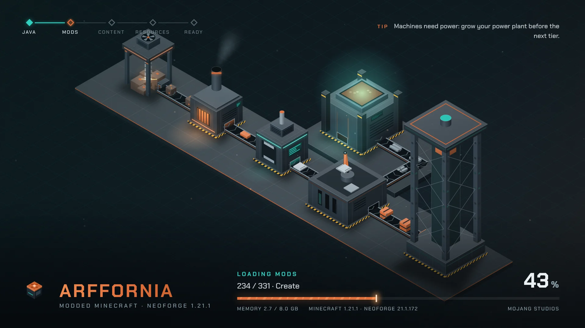 | [MP4](007-loading-and-title-screen/loading-a.en.mp4) · [animated](007-loading-and-title-screen/loading-a.en.anim.webp) | [open](007-loading-and-title-screen/previews/loading-a.html) |
| **Loading B · Maquette**: light architectural model, brand banner palette, tilt-shift; centred card | 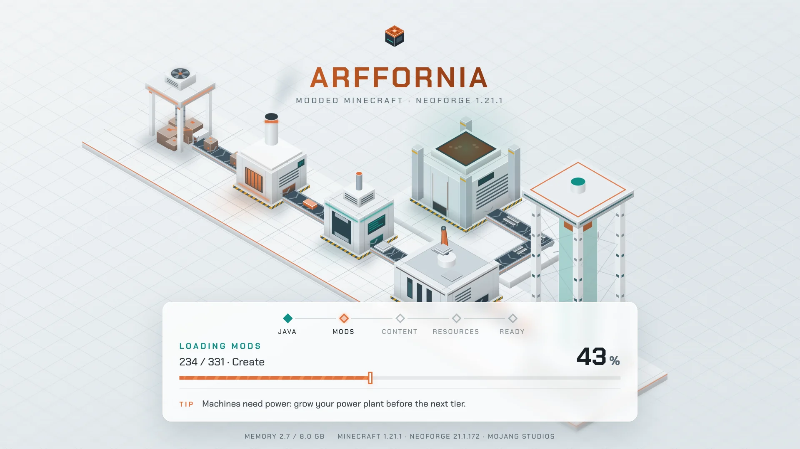 | [MP4](007-loading-and-title-screen/loading-b.en.mp4) · [animated](007-loading-and-title-screen/loading-b.en.anim.webp) | [open](007-loading-and-title-screen/previews/loading-b.html) |
| **Title A · Control Room**: side menu, server status in the Play button, player progress and news cards | 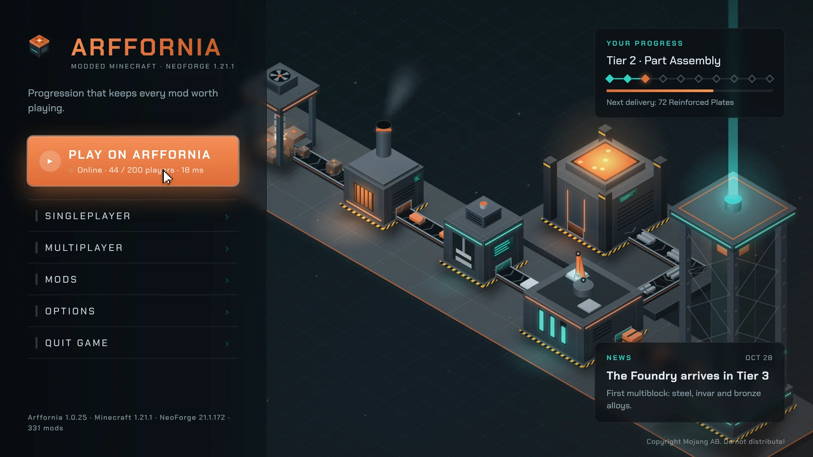 | [MP4](007-loading-and-title-screen/title-a.en.mp4) · [animated](007-loading-and-title-screen/title-a.en.anim.webp) | [open](007-loading-and-title-screen/previews/title-a.html) |
| **Title B · Maquette Hero**: centred logo, bottom dock, chips | 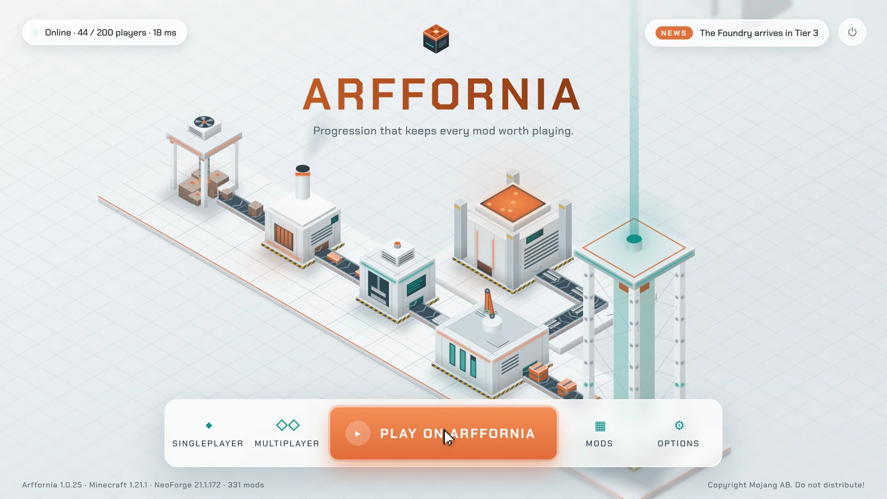 | [MP4](007-loading-and-title-screen/title-b.en.mp4) · [animated](007-loading-and-title-screen/title-b.en.anim.webp) | [open](007-loading-and-title-screen/previews/title-b.html) |

French stills: [loading A](007-loading-and-title-screen/loading-a.fr.webp),
[loading B](007-loading-and-title-screen/loading-b.fr.webp),
[title A](007-loading-and-title-screen/title-a.fr.webp),
[title B](007-loading-and-title-screen/title-b.fr.webp); translation keys shown:
[loading A keys](007-loading-and-title-screen/loading-a.keys.webp). Gallery:
[previews/index.html](007-loading-and-title-screen/previews/index.html).

The machines are the tier plan's first line: **Miner → Smelter → Constructor → Assembler →
Space Elevator**, with the **Foundry** feeding steel rods into the Assembler. Ore becomes
ingots, then plates, then reinforced plates, then packages that ride the elevator.

## Goals / non-goals

**Goals**

- One visual story from launcher click to title screen, no red Mojang/NeoForge screen.
- Player-facing text in EN and FR from lang keys, no text baked into images.
- Machines come from the same Blockbench sources as the in-game blocks ([005](https://github.com/Arffornia/docs/blob/docs/tooling-research/docs/specs/005-3d-model-pipeline.md)), so the screens update when a machine is added.
- No measurable boot slowdown; safe fallback to the stock screen on any error.
- Automated screenshots of every phase, compared to approved baselines in CI.

**Non-goals**

- A web (Chromium) title screen. Deferred with the web layer of [006](https://github.com/Arffornia/docs/blob/docs/tooling-research/docs/specs/006-gui-design-system.md).
- Replacing later resource reloads (F3+T, resource-pack switch). They keep the vanilla overlay in v1.
- Showing a real world as the menu background (vanilla panorama or a loaded level).

## Research: how a NeoForge 1.21.1 client boots, and who can draw when

Checked against FML 4.0.39 (the version NeoForge 21.1.172 pulls) and NeoForge `1.21.1` sources on 2026-10-29.

```mermaid
sequenceDiagram
  participant L as Launcher (Electron)
  participant J as JVM + ModLauncher
  participant F as FML early window (provider)
  participant M as Minecraft + mods
  L->>J: spawn java (download/verify done before)
  Note over L: only the launcher can draw here
  J->>F: ModDirTransformerDiscoverer.earlyInitialization → ImmediateWindowHandler.load
  Note over F: window appears; provider renders on its own thread (20 Hz)
  F->>M: mod discovery, mixins, mod construction (provider keeps drawing)
  M->>F: Window() → setupMinecraftWindow (handoff, same window)
  M->>F: first resource reload → loadingOverlay(): NeoForgeLoadingOverlay draws the provider framebuffer every frame
  M->>M: fade out (1 s + 1 s) → TitleScreen (ScreenEvent.Opening can replace it)
```

| Step | Fact | Source |
|---|---|---|
| Provider lookup | `ImmediateWindowHandler.load` uses `ServiceLoader` on the **SERVICE** module layer and picks the provider whose `name()` equals `earlyWindowProvider` in `config/fml.toml`; it falls back to a dummy provider (no early window) if none matches. | [ImmediateWindowHandler](https://github.com/neoforged/FancyModLoader/blob/1.21.1/loader/src/main/java/net/neoforged/fml/loading/ImmediateWindowHandler.java) |
| Who reaches the SERVICE layer | Any jar in `mods/` that declares a service for `ImmediateWindowProvider` (or the other FML SPIs) is moved to the SERVICE layer before mods are discovered, and is excluded from mod loading. A normal mod jar cannot be the provider. | [TransformerDiscovererConstants](https://github.com/neoforged/FancyModLoader/blob/1.21.1/loader/src/main/java/net/neoforged/fml/loading/TransformerDiscovererConstants.java), [ModDirTransformerDiscoverer](https://github.com/neoforged/FancyModLoader/blob/1.21.1/loader/src/main/java/net/neoforged/fml/loading/ModDirTransformerDiscoverer.java) |
| Config keys (1.21.1) | `earlyWindowControl`, `earlyWindowProvider` (default `fmlearlywindow`), `earlyWindowWidth`/`Height` (854×480), `earlyWindowFBScale`, `earlyWindowMaximized`, `earlyWindowSkipGLVersions`, `earlyWindowSquir`. No theme key. | [FMLConfig](https://github.com/neoforged/FancyModLoader/blob/1.21.1/loader/src/main/java/net/neoforged/fml/loading/FMLConfig.java) |
| Stock window | Renders into a fixed **854×480 × FBScale** framebuffer, scaled to the window; redraws every **50 ms** on a scheduler thread; GL 4.6 → 3.2 core fallback; centred on the primary monitor; red or black scheme from `options.txt` `darkMojangStudiosBackground`. | [DisplayWindow](https://github.com/neoforged/FancyModLoader/blob/1.21.1/earlydisplay/src/main/java/net/neoforged/fml/earlydisplay/DisplayWindow.java) |
| Handoff and overlay | Minecraft's `Window` asks the provider for the window (`setupMinecraftWindow`). The first resource reload asks it for a `LoadingOverlay`. NeoForge's `NeoForgeLoadingOverlay.newInstance` takes a concrete `DisplayWindow` and blits its framebuffer until the reload ends, then fades for 2 s. | [NeoForgeLoadingOverlay](https://github.com/neoforged/NeoForge/blob/1.21.1/src/main/java/net/neoforged/neoforge/client/loading/NeoForgeLoadingOverlay.java), NeoForge 21.1.172 `Minecraft.java.patch` |
| Later reloads | Only the first reload goes through the provider; later ones construct the vanilla `LoadingOverlay` (Mojang logo). | same patch |
| Title screen | `ScreenEvent.Opening` is cancellable and has `setNewScreen`, so a mod can replace `TitleScreen`. | [ScreenEvent](https://github.com/neoforged/NeoForge/blob/1.21.1/src/main/java/net/neoforged/neoforge/client/event/ScreenEvent.java) |
| Newer versions | FML for 1.21.8+ has data-driven early-screen **themes** (`theme-default.json`, `earlyLoadingScreenTheme`, background image since FML 10.0.33). **Not available on 1.21.1.** | [theme-default.json (1.21.8)](https://github.com/neoforged/FancyModLoader/blob/1.21.8/earlydisplay/src/main/resources/net/neoforged/fml/earlydisplay/theme/theme-default.json), [FML changelog](https://maven.neoforged.net/releases/net/neoforged/fancymodloader/loader/11.0.7/loader-11.0.7-changelog.txt) |
| Fallback switch | `earlyWindowControl=false` disables the early window (NeoForge's advice for driver problems). | [NeoForge display errors](https://neoforged.net/meta/displayerrors/) |

### Limitations

1. **Nothing in Minecraft can draw before ModLauncher starts.** The download/verify phase and JVM start (about 1–3 s, to be measured) belong to the launcher.
2. **A mod jar starts too late.** Only a separate SERVICE-layer jar named in `fml.toml` replaces the early window, and it has no Minecraft classes, renderer, resource packs or language manager: raw OpenGL 3.2 core + LWJGL in an 854×480×scale framebuffer, on its own thread at 20 Hz until the handoff.
3. **No theming API on 1.21.1.** A custom look means subclassing the LGPL-2.1 `DisplayWindow` and reaching private fields by reflection (the approach of Simple Custom Early Loading), because NeoForge's overlay only accepts a `DisplayWindow`.
4. **Per-instance and optional.** `fml.toml` lives in the game folder (Provisioning must ship it); a player who sets `earlyWindowControl=false` gets the stock path; later reloads show the vanilla Mojang overlay.
5. **No real 3D before the title screen.** Machines in the loading screen are baked sprite frames; real-time block rendering starts with the title screen.

### Existing solutions

| Option | What it does on 1.21.1 | Licence | Verdict |
|---|---|---|---|
| [Simple Custom Early Loading](https://modrinth.com/mod/simple-custom-early-loading) ([source](https://github.com/lukaskabc/SimpleCustomEarlyLoading)) | Provider jar (`earlyWindowProvider = "SimpleCustomEarlyLoading"`), `extends DisplayWindow`, positioned images, APNG animation, progress bar toggles; 2.2 for NeoForge 1.21.1 (2026-03-19) | LGPL-2.1+ | Proof that our approach works in production (68k downloads). Too static for a living factory and no i18n of our own. Reference implementation. |
| [Drippy Loading Screen](https://modrinth.com/mod/drippy-loading-screen) + [Early Loading Module](https://www.curseforge.com/minecraft/mc-mods/drippy-early-loading-module) | FancyMenu-based overlay customisation; the module customises the NeoForge early screen (described as "very barebones"); 3.1.5 for 1.21.1 (2026-08-01) | DSMSL (custom) | **Already in the pack**, configured with another modpack's logo and background art (DireWolf20). No live scene, no dynamic status. Replace. |
| [FancyMenu](https://modrinth.com/mod/fancymenu) | In-game editor for menus incl. title screen; 3.9.14 for 1.21.1 | DSMSL (custom) | No-code but cannot render our live machine models or server data well. Replace for the title screen. |
| Paladium ("Modded" network) | Replaced native menus with web UI through MCEF ([former lead web developer](https://mathislebonniec.fr/projects/paladium)); launcher in Vue + Electron ([launcher developer](https://gaetan.dezeiraud.com/softwares/paladium/)) | — | Same idea as the deferred web layer of 006; no public source for their loading screen. |

### Options and trade-offs

| # | Option | Covers | Pros | Cons |
|---|---|---|---|---|
| L1 | **Launcher splash** (Electron window plays the scene until the game's first frame) | click → early window | Covers download, verify and JVM start; web tech, reuses the preview engine | A second window: needs a careful crossfade; Electron 38 is EOL (upgrade first, launcher audit) |
| L2 | **Custom early-window provider** (`arffornia-earlywindow.jar`, SERVICE layer) | ~1 s after JVM start → title screen | Same window for the whole boot, full control, keeps NeoForge's overlay and handoff | Reflection into FML internals: pin and test every NeoForge bump; LGPL subclass; 20 Hz before handoff unless rescheduled |
| L3 | Drippy / FancyMenu as today | overlay + barebones early screen | No code | Licence, weight, static, third-party art |
| L4 | Simple Custom Early Loading with an APNG | early window | No code | One heavy APNG, static composition, no factory logic |
| L5 | Mod-only overlay replacement | last ~40 % (reload) | Simple | Starts late; the stock red screen stays |

**Recommendation: L1 + L2 for loading, T1 for the title screen** (below), then remove Drippy
and FancyMenu from the pack.

## Design

### Architecture

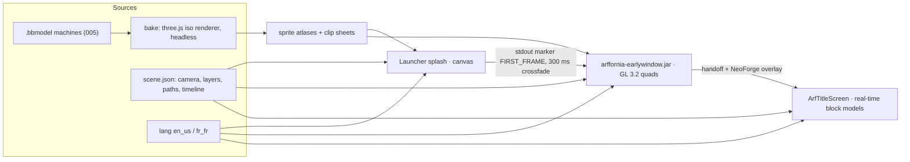

| Part | Repo / location | Notes |
|---|---|---|
| `scene.json` | Arffornia_Mods `screens/scene.json` (exported to the launcher at build) | One layout for all three renderers: iso camera, layers, machine anchors, conveyor paths, item kinds, power thresholds. Keeps the handoffs seamless. |
| Baker | Arffornia_Mods `tools/screens-bake/` (Node + three.js, headless Chromium, same runner as 005 turntables) | Renders each `.bbmodel` at the scene's iso camera into trimmed sprites and clip sheets, 1× and 2×. CI fails if outputs are stale. |
| `arffornia-earlywindow` | Gradle subproject of Arffornia_Mods, own jar, no Minecraft deps | `ArffEarlyWindow extends DisplayWindow`, `name() = "arffornia"`. Replaces the stock elements with ours, keeps handoff and overlay. Any exception → log + fall back to the stock elements. Licence note: subclassing LGPL-2.1 code from a separate jar is fine; keep its source public. |
| Title screen | Arffornia_Mods `client/screen/title/` | `ArfTitleScreen` opened through `ScreenEvent.Opening` when the target is `TitleScreen`. Diorama renders the real block models (`BlockRenderDispatcher` in an orthographic iso `PoseStack`), items with `ItemRenderer`, moving parts through the machines' BER/GeckoLib animations. Widgets from the 006 kit. Keeps "Copyright Mojang AB. Do not distribute!" and the NeoForge Mods button. |
| Launcher splash | Arffornia_Launcher `src/renderer/splash/` | Canvas engine from these previews, frameless window centred like FML's (854×480 × scale by default). Hides on the `[arffornia-earlywindow] FIRST_FRAME` stdout line (MCLC `data` event), on exit, or after 60 s. Its own steps fill the first 4 % of the bar. |
| Pack config | Arffornia_Provisioning `config/launcher/storage/config/fml.toml` | `earlyWindowProvider = "arffornia"`, `earlyWindowFBScale = 2`. Ship the provider jar in the launcher mod list. Remove FancyMenu/Drippy configs once T1 ships. |

### How each element is rendered

| Element | Launcher splash | Early window (provider) | Title screen |
|---|---|---|---|
| Background, floor slab, grid, far silhouettes | canvas 2D (as previews) | one baked layer PNG per scale | baked layer or real blocks |
| Machine bodies | baked sprites | **baked sprites** from Blockbench | **real-time block models** |
| Moving parts (fan, drill, press, arm, capsule) | sprite clips | sprite-sheet clips (24–48 frames per loop) | BER / GeckoLib animation |
| Conveyor belts | sprite strip | 8-frame belt strip, UV scroll | real conveyor model + `.mcmeta` texture animation |
| Items on belts | sprites on paths | one sprite per item kind, positions computed from the path and the belt clock | `ItemRenderer.renderStatic` on the same paths |
| Glow, light pools, beacon beam | `lighter` compositing | additive quads (`glBlendFunc(GL_ONE, GL_ONE)`), intensity in code | additive render type |
| Smoke, sparks, dust | particles | CPU particles as quads | same |
| Text | web fonts | STB TrueType (FML `SimpleFont`) with Chakra Petch (OFL) | vanilla font for body, Chakra Petch TTF for headings ≥ 2× scale |
| Progress, stage graph, power-on | from launcher steps | from `StartupNotificationManager` progress bars and messages | n/a |

Items follow belts deterministically: position = belt clock × speed + phase, and the phase of
each belt is chained to the machine before it, so a plate leaves the Constructor a fixed
time after an ingot enters it (see `engine.js`, `buildLine`).

### Player experience

1. **Click Play.** The launcher window dims; the splash shows the factory at rest, bar at 0 %, "Starting Java & NeoForge".
2. **Early window.** Same picture in the game window; the splash crossfades out. The Miner powers on (flash), belts start; "Discovering mods · 331 mods found".
3. **Mods load.** Each threshold powers a machine: Smelter 11 %, Constructor 26 %, Foundry 42 %, Assembler 58 %, Space Elevator 76 %. Detail line shows `152 / 331 · Create`. Tips rotate every 5 s.
4. **Resources.** "Stitching atlas 3 / 7". The overlay phase draws the same framebuffer at full frame rate.
5. **Ready.** Bar turns teal, the elevator launches a capsule and the beam surges; the overlay fades into the title screen whose factory is the same scene, now rendered with real models, with the menu sliding in.

### i18n

| Surface | Mechanism |
|---|---|
| Early window | No Minecraft language manager. The provider reads `lang:` from `options.txt` (as `DisplayWindow` already reads `darkMojangStudiosBackground`) and loads `assets/arffornia/lang/early/<code>.json` from its own jar, fallback `en_us`. FML messages are English; we map known progress labels to our stage keys and show mod names as they are. |
| Title screen | Normal lang files, `Component.translatable`, vanilla keys reused where they exist (`menu.singleplayer`, `menu.multiplayer`, `menu.options`, `menu.quit`, `fml.menu.mods`). |
| Launcher splash | vue-i18n, same keys exported from the mod's `en_us`/`fr_fr` at build. |
| Fit | French is ~20 % longer: labels shrink one step instead of wrapping (see the French Title A still); the harness *text-fits* check from 004 applies. |

Keys (all in the previews): `gui.arffornia.brand.tagline`,
`gui.arffornia.loading.stage.{boot,discovery,mods,registries,resources,ready}`,
`gui.arffornia.loading.detail.{found,registries,atlas,ready}`, `gui.arffornia.loading.tip.{label,1,2,3}`,
`gui.arffornia.loading.pip.{java,mods,content,resources,ready}`, `gui.arffornia.loading.memory`,
`gui.arffornia.title.{tagline,play,server.online,progress,tier,next,news,news.date,news.headline,news.body,version}`,
`gui.arffornia.tier.<n>`.

### Configuration

| File | Key | Default | Purpose |
|---|---|---|---|
| `config/fml.toml` (shipped) | `earlyWindowProvider` | `"arffornia"` | select our provider |
| | `earlyWindowFBScale` | `2` | 1708×960 framebuffer for sharp HiDPI |
| `config/arffornia-earlywindow.toml` | `direction` | from D1 | `night` or `maquette` |
| | `maxFps` | `60` | provider redraw rate (stock is 20 Hz) |
| | `reducedMotion` | `false` | static factory, bar only |
| | `tips`, `memory` | `true` | toggles |
| JVM property | `arffornia.earlywindow.testClock` | unset | freeze the animation clock for tests (seconds) |
| `config/arffornia-client.toml` | `titleScreen.enabled` | `true` | fall back to vanilla `TitleScreen` |
| | `titleScreen.server` | `arffornia.com` | Play button target and status ping |
| | `titleScreen.cards` | `progress,news` | API cards (timeouts 3 s, cached) |

### Performance budget

| Item | Budget | How we check |
|---|---|---|
| Boot time | no increase beyond noise (≤ 1 %) vs the stock early window | harness logs phase timestamps; compare 5 runs each |
| Provider CPU | ≤ 5 % of one core; ≤ 2 ms per frame at 1708×960 | provider logs frame time; probe measured 3.7 ms/frame for simple quads on **software** llvmpipe at 854×480 |
| Provider memory | ≤ 64 MB textures (static bodies in the background layer, only moving parts in clip sheets), jar ≤ 8 MB | asset report from the baker |
| Title screen | ≥ 60 FPS at 1080p on an Intel UHD 620 / Apple M1 class GPU; ≤ 2,000 block quads in the diorama; no world load | F3 + harness frame-time log |
| Launcher splash | 60 FPS canvas, paused when hidden | Chromium performance trace |

## Testing

### Feasibility, run on 2026-10-29 (software only, no GPU)

| Check | Result |
|---|---|
| Headless GL like the early window: GLFW + GL core under `xvfb-run`, Mesa llvmpipe, offscreen FBO → `glReadPixels` → PNG, pixel assertion | **Pass.** `GL_RENDERER=llvmpipe (LLVM 20.1.2)`, `GL_VERSION=4.5 Core Mesa 25.2.8`, 40 frames, 3.69 ms/frame ([probe image](007-loading-and-title-screen/harness/early-window-probe.png)) |
| FML's real `DisplayWindow` (FML 4.0.39) driven outside Minecraft with fake mod progress, captured with `ffmpeg -f x11grab` at T = 4 s | **Pass.** The stock NeoForge 1.21.1 screen renders headless ([capture](007-loading-and-title-screen/harness/fml-early-window.png)); 117 ticks in 6 s |
| Baseline diff (`shotdiff.py`, tolerance 24/255 per channel, limit 0.5 %) | Identical probe runs: 0.000 % **pass**. Injected 200-px defect: 0.049 % **fail** (limit 0.01 %). Two captures of the stock window: 0.59 % **fail**, still 0.62 % with masks, because the fox animation frame follows the wall clock ([diff](007-loading-and-title-screen/harness/fml-diff-masked.png)) → our provider needs a frozen test clock. |
| Full `runClient` with the Arffornia mod and the 331-mod pack | **Not run**: the provider does not exist yet, and the session's disk was below its free-space floor. First task of the pilot. |

The probe sources (`EarlyWindowProbe.java`, `FmlEarlyWindowShot.java`, `shotdiff.py` and
the shell wrappers) are in [`007-loading-and-title-screen/harness/`](007-loading-and-title-screen/harness/README.md).

### Pipeline

| Layer | What | Where | Time |
|---|---|---|---|
| 1. Provider visual test | Run `ArffEarlyWindow` **without Minecraft** (like `FmlEarlyWindowShot`) with `testClock` and a scripted progress feed; write `loading.<direction>.<locale>.<t>.png` from inside the provider (`glReadPixels`) at t = 0.5, 3, 6, 9, 12, 13.5 | Gradle task `:earlywindow:visualTest` under `xvfb-run` | seconds |
| 2. Full client run | `runClientTest` (dev-only source set, spec 004) with `-Darffornia.screens.test=early@3,overlay@first,title@60f`: provider dumps the early frames; a mod hook takes `Screenshot.takeScreenshot` during the overlay and after the title screen has rendered 60 frames; loops `en_us`/`fr_fr` and GUI scale 2/3/4 on the title screen; asserts `GL_RENDERER` contains `llvmpipe`; logs phase timestamps; exits with a code | `ui-tests.yml` (label `ui` + nightly), `ubuntu-latest`, `apt-get install xvfb mesa-utils libgl1-mesa-dri`, cache `~/.gradle` (incl. `neoformruntime/assets`) | minutes |
| 3. Diff | `shotdiff.py` against `src/test/screens/baselines/*.png`, masks for the memory line; contact sheet + diff images uploaded as artifacts; `make screens-approve` copies new shots to baselines in the same PR | CI | seconds |
| 4. Manual checklist | below | Brian, before a release | 20 min |

### Manual checklist

- [ ] Launcher → game: no red or white flash, splash crossfades into the game window at the same place and size.
- [ ] Windows, Linux, **macOS arm64**: early window appears; handoff works; title screen at 60 FPS.
- [ ] Resize, maximise and move the window during loading; fullscreen option on; 4K/HiDPI sharpness (`earlyWindowFBScale`).
- [ ] `earlyWindowControl=false`: stock path still boots; title screen still ours.
- [ ] French: no overflow at GUI scale 2, 3, 4 and at 854×480.
- [ ] Reduced motion: factory static, bar animates.
- [ ] Crash during mod loading: the error screen still shows (provider must not hide it).
- [ ] F3+T: vanilla overlay, no crash.
- [ ] Server offline / API down: Play button shows "offline", cards hide after 3 s, no stutter.

## Migration

- Provisioning: remove `config/fancymenu/` assets that come from another modpack (logo and
  background art) now; keep FancyMenu/Drippy until the provider and title screen ship, then
  drop both mods and their configs.
- No world or server change. Client-only; servers do not need the provider jar.

## Round 2 (2026-10-31): UI directions, the early window, web menus

Brian's feedback on round 1: the 3D machines are what he wanted; the buttons and panels on top
are not. He wants something modern rather than "gamer", matching the launcher's look (which may
change later). Round 2 keeps the factory and proposes five UI directions over it.

**The machines are now real models.** The mock machines were extracted into Blockbench files
(`.bbmodel`) in the proposed `Arffornia/arffornia-assets` repository, which re-renders every
derived asset (stills, loops, sprite sheets, the GitHub profile's animated SVG, glTF) when a model
changes. All round 2 images come from that pipeline (three.js, deterministic).

| Direction | Idea | Bold choice |
|---|---|---|
| **A · Honeycomb** | The menu is a mosaic of hexagonal tiles that continues the floor grid; the Play tile carries the Space Elevator; loading fills the six tiles clockwise | the hex mosaic Brian liked in an old menu mod |
| **B · Drafting sheet** | The screen is an engineering drawing: leader lines name each machine, the menu is the drawing's title block; loading is a revision table | engineering-drawing conventions as the UI |
| **C · Launcher continuity** | Same tokens as today's launcher (Montserrat, plum, orange): a floating dock, a news card, a status chip | zero visual break between launcher and game |
| **D · Shift board** | No panels: the menu is type (Archivo, wide for actions, narrow for status); the six machines double as the six loading steps | typography only |
| **E · Model studio** | Daylight: the factory is a scale model, the menu a pinned spec sheet with keyboard hints | the light theme |

| | Title | Loading |
|---|---|---|
| A · Honeycomb | 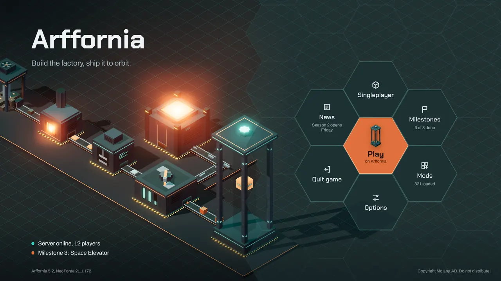 | 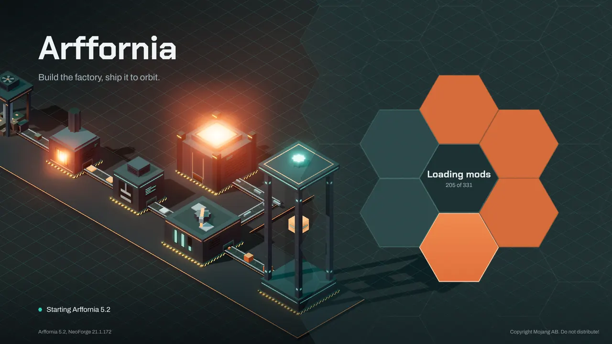 |
| B · Drafting sheet | 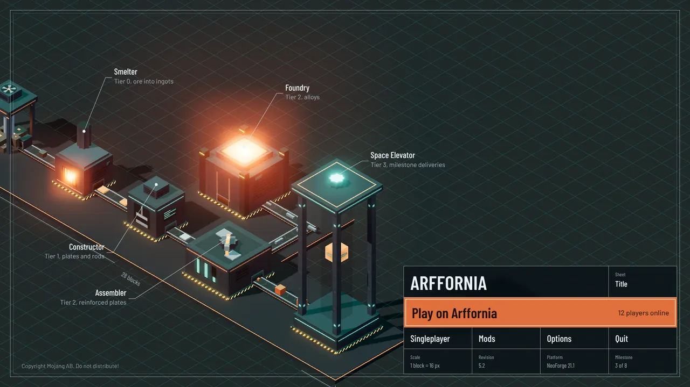 | 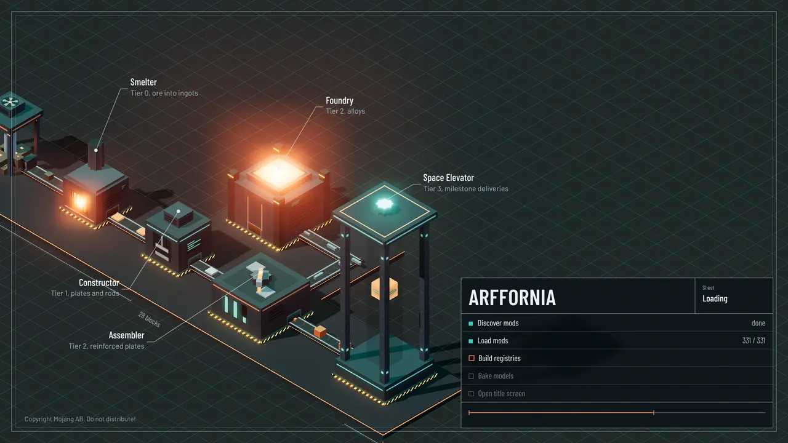 |
| C · Launcher continuity | 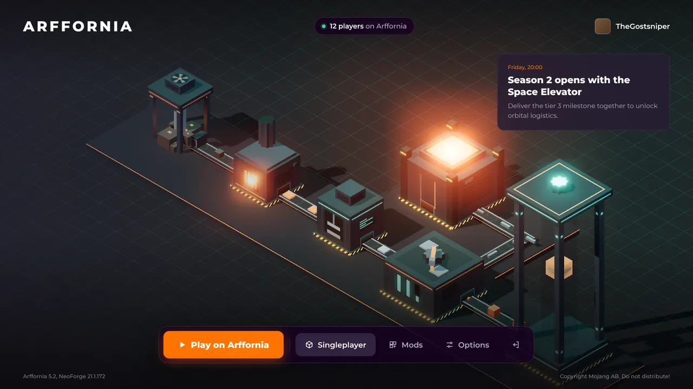 | 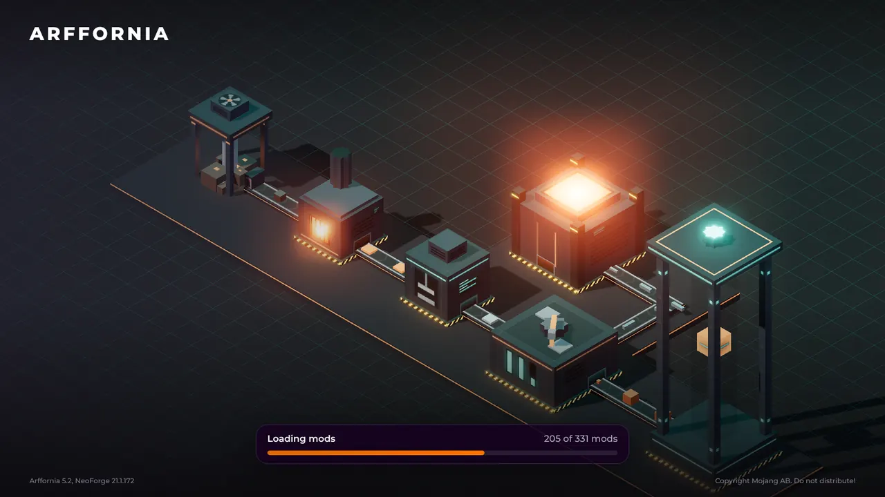 |
| D · Shift board | 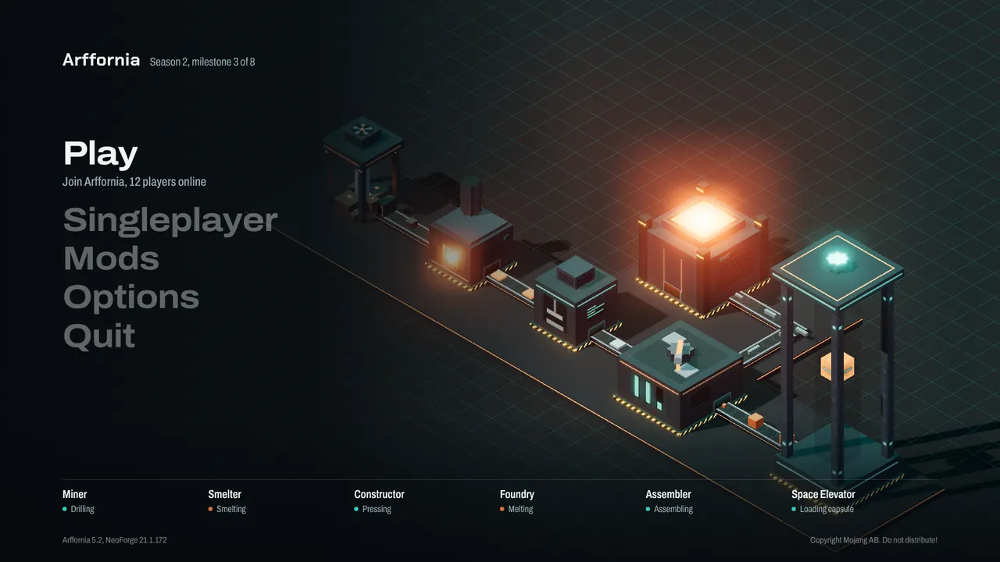 | 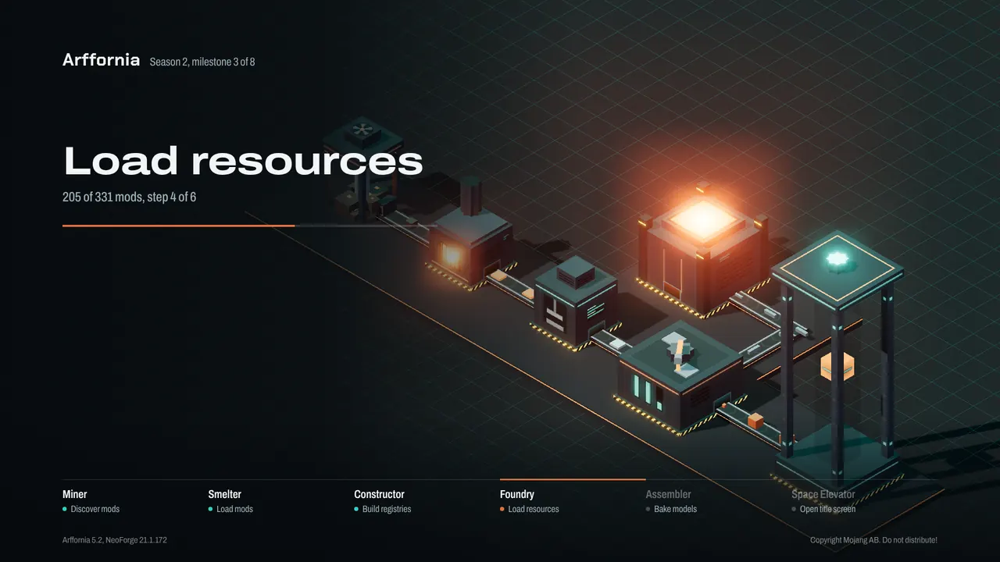 |
| E · Model studio | 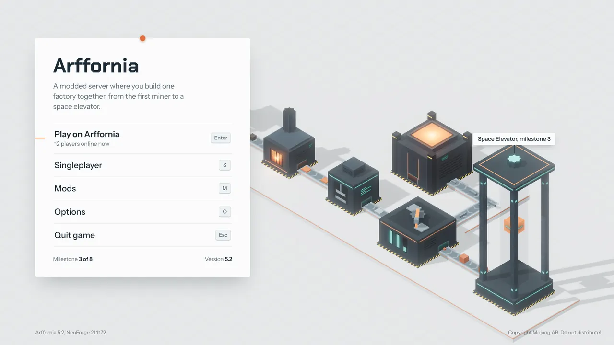 | 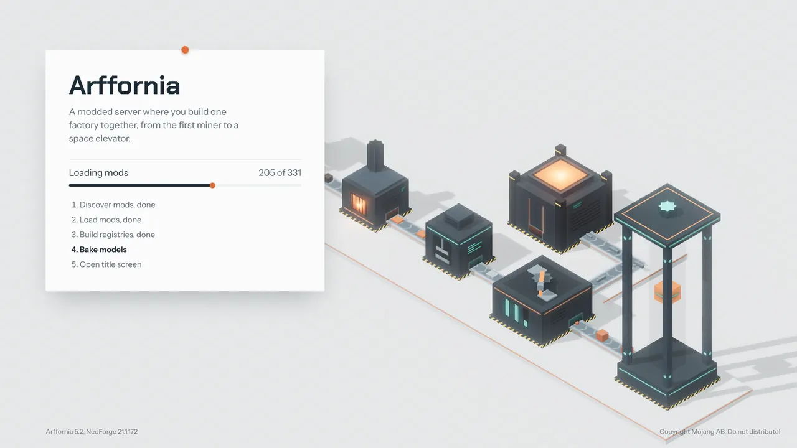 |

Clips and the machine turntables are in the review gallery linked from the PR. Each direction is a
single HTML page over the same rendered factory, so it can be iterated in minutes.

**Early window (before Minecraft starts).** Brian remembered Forge 1.7.10's animated anvil and asked
whether a GIF-like animation is possible there. Tested on 2026-10-31:

- FML 1.21.1's stock early window **already plays a 28-frame sprite strip** (the running fox,
  `fox_running.png`, 256×128 per frame, one frame per 20 Hz tick). Putting our strip on the
  classpath under that name made the real FML 4.0.39 window play the Arffornia Constructor press
  instead, at 20 fps (recorded under Xvfb). Proof only: shipping goes through our own provider.
- Our own GL 3.2 renderer drawing exactly what the provider would draw (baked backdrop + one
  sprite quad from a 33-frame sheet + the progress bar): **10 ms per tick on a software renderer**
  (llvmpipe), budget 50 ms; textures 10.6 MB; load and upload 29 ms. A static branded image costs
  the same minus the sprite.
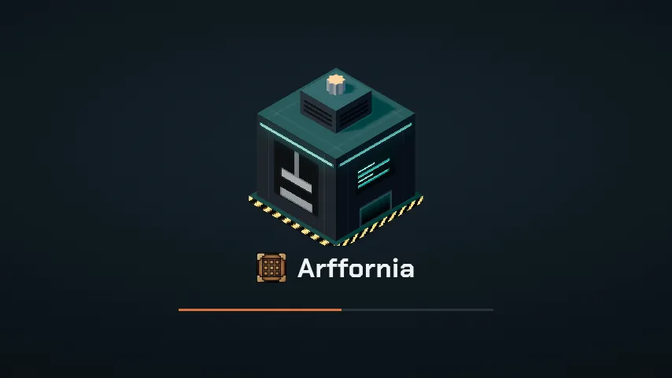 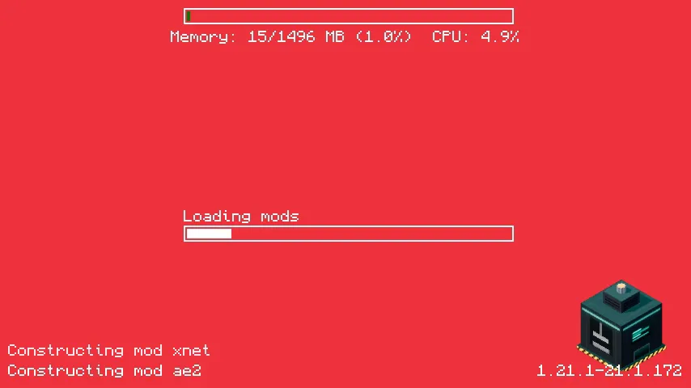

- Conclusion: a 20 fps loop is cheap and safe. Recommendation unchanged on D3 (own provider), with
  the press loop as the "anvil" homage; a static branded image stays the fallback.

**Web menus (Paladium-style).** MCEF embeds Chromium (LGPL, ~150 MB downloaded on first launch from
CinemaMod's server, Windows/macOS/Linux x86_64 and arm64); WebGUI (MIT) builds on it and supports
NeoForge 1.21.1 for HTML/CSS/JS screens and HUDs. TesseraUI (LGPL, NeoForge 1.21.1) takes the
other route: HTML-like templates and CSS rendered as native widgets, no browser, no JavaScript.
Recommendation: native screens for the title and loading screens (they must open instantly, and
the early window cannot use a browser anyway); evaluate TesseraUI for menus and machine GUIs;
keep MCEF/WebGUI for content-heavy pages only (shop, news), loaded on demand, if ever. How
Paladium does it was not verified from a public source.

**D5 done:** the DireWolf20/FTB logo and background are replaced in Provisioning (PR linked below).

## Decisions needed

| # | Question | Options | Recommendation |
|---|---|---|---|
| D1 | Loading screen look (scene) | (a) A · Night Shift; (b) B · Maquette; (c) mix | **(a)**: emissive power-on reads best; B's palette fits the launcher and website light theme |
| D1b | UI direction over the scene (round 2) | A Honeycomb; B Drafting sheet; C Launcher continuity; D Shift board; E Model studio; or a mix | **D Shift board** for the title (modern, no panels, the factory stays the hero) with **A Honeycomb** as the alternative if the hex identity wins; loading uses the same direction |
| D2 | Title screen layout (round 1) | (a) A · Control Room; (b) B · Maquette Hero | superseded by D1b |
| D3 | How to take over the early window | (a) own provider jar; (b) keep Drippy + FancyMenu; (c) Simple Custom Early Loading + APNG | **(a)**, with the 20 fps press loop (proved, see round 2) |
| D9 | Web-rendered menus | (a) native screens, TesseraUI for menus/GUIs; (b) MCEF/WebGUI for all menus; (c) MCEF only for content pages | **(a)** |
| D4 | Launcher splash to cover JVM start | (a) yes, after the Electron upgrade; (b) no | **(a)** |
| D5 | Third-party art currently shipped in `config/fancymenu/assets` | (a) remove now; (b) keep until replaced | **(a)** |
| D6 | Which machines appear before their models exist | (a) tiers 0–3 as teasers, mocks replaced as 005 models land; (b) only released machines | **(a)** |
| D7 | Small "Mojang Studios" credit on the loading screen | (a) keep, small; (b) remove | **(a)** (the title screen keeps the vanilla copyright line in any case) |
| D8 | UI test cadence | (a) label `ui` + nightly; (b) every PR | **(a)**, as in 004 |

## Work breakdown

| # | Title | Repo | Acceptance criteria | Effort |
|---|---|---|---|---|
| 1 | Remove other-modpack art from the FancyMenu config | Provisioning | No third-party logo/background in `config/launcher/storage/config/fancymenu/assets`; neutral placeholder | S |
| 2 | `scene.json` + baker (Blockbench → iso sprites and clip sheets, 1× and 2×) | Mods | Bakes the 6 tier 0–3 machines; stale-output check in CI; atlas report ≤ 64 MB | M |
| 3 | `arffornia-earlywindow` subproject: provider shell | Mods | `extends DisplayWindow`, selected by `earlyWindowProvider = "arffornia"`; reflection guarded, falls back to stock elements on error; logs `FIRST_FRAME` | M |
| 4 | Provider renderer: layers, clips, belts, items, glows, text, progress mapping, power-on timeline, i18n, `testClock` | Mods | Layer-1 visual test matches approved stills of D1 in EN/FR | L |
| 5 | Provider frame rate and handoff polish | Mods | ≥ 50 FPS before handoff (or documented 20 Hz), no flash at handoff, overlay fade into title | S |
| 6 | `ArfTitleScreen` (D2) with live diorama and menu | Mods | Opens instead of `TitleScreen`; all vanilla actions work; real models; EN/FR fit at scales 2–4; 60 FPS budget | L |
| 7 | Title screen cards: server status, player progress, news | Mods + Website | 3 s timeouts, cache, offline state; no blocking on the render thread | M |
| 8 | Screen tests: layer 1 + layer 2 hooks, `shotdiff`, baselines, `ui-tests.yml` | Mods | CI job uploads contact sheet and diffs; fails on a 1 % change; `GL_RENDERER` asserted | M |
| 9 | Launcher splash + handoff on `FIRST_FRAME` | Launcher | Splash plays from click to first game frame, crossfade ≤ 300 ms, timeout 60 s; EN/FR | M |
| 10 | Ship `fml.toml` and the provider jar; drop Drippy/FancyMenu | Provisioning | Fresh install boots with the new screens; mods removed from both mod lists | S |
| 11 | Perf measurement and manual checklist pass on Windows, Linux, macOS arm64 | all | Table of boot timings stock vs ours; checklist ticked | S |

Order: 1 now; 2–5 (loading) and 6–7 (title) in parallel once D1–D3 are answered; 8 with
the first of them; 9–10 last.
