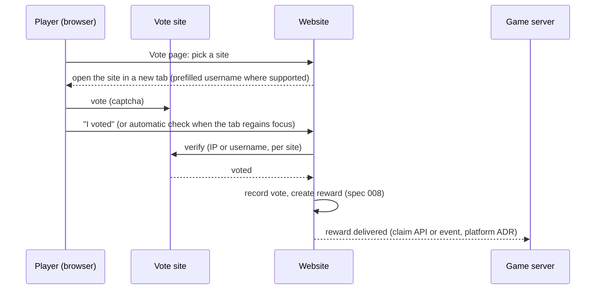

# 010 · Vote sites

| | |
|---|---|
| **Status** | Draft: needs decisions |
| **Milestone** | M3 · Gameplay foundations |
| **Repos** | Arffornia_Website (vote page, verifiers), Arffornia_Proxy (NuVotifier forwarding), infra (Votifier port) |
| **Related** | [008](008-economy-and-rewards.md) (vote rewards) · [012](012-legal-compliance.md) (IP retention) · Website [#92](https://github.com/Arffornia/Arffornia_Website/pull/92) (trusted proxies), [#97](https://github.com/Arffornia/Arffornia_Website/pull/97) (rate limits) |

## Summary

Pick **four vote sites** (three French, one international) plus an optional fifth, verify
votes by **pulling the site's API** wherever possible, and keep Votifier only for sites
that only push. Register them only when the feature works end to end **and the server is
reachable**, because listing sites check the server and the vote callback before they
approve it.

## What exists

- Website: vote page, a `VoteVerifierInterface`, one verifier (`SmcVoteVerifier`,
  serveurs-minecraft.org, by IP), `config/voting.php`, a 24 h cooldown, a trusted endpoint
  `/vote/nuvotifier` for Votifier pushes. The reward is a hard-coded diamond (to replace,
  spec 008).
- **Arffornia_Proxy** is a Velocity *plugin*. Brian asked why "Votes" shows next to the
  proxy. Answer: the Velocity proxy itself, which routes players, is configured in
  `infra`. The plugin's **only** job today is to forward NuVotifier votes to the website.
  The repo name suggests more than it does (D5).
- Votifier is **raw TCP** (port 8192), not HTTP. It cannot go through the HTTP gateway,
  which is why it needs its own port forward. The platform agent owns that network
  question. Pull verification below removes the need for Votifier on most sites.

## Selected sites

Verification URLs come from the open-source Azuriom vote plugin
([VoteChecker.php](https://github.com/Azuriom/Plugin-Vote/blob/master/src/Verification/VoteChecker.php)),
which many French servers use; recheck each one at registration time.

| Site | Audience | Verification | Needs | Notes |
|---|---|---|---|---|
| [serveurs-minecraft.org](https://www.serveurs-minecraft.org) | FR | pull by IP: `/api/is_valid_vote.php?id={id}&ip={ip}&duration=5&format=json` | server id | already integrated (`SmcVoteVerifier`) |
| [top-serveurs.net](https://top-serveurs.net) | FR, the largest French list | pull by IP: `api.top-serveurs.net/v1/votes/check-ip?server_token={token}&ip={ip}` (also offers Votifier) | server token | very visible in the French modded community |
| [serveur-prive.net](https://serveur-prive.net) | FR | pull by IP: `/api/v1/servers/{id}/votes/{ip}` | API key | |
| [minecraft-mp.com](https://minecraft-mp.com) | international | pull by **username**: `/api/?object=votes&element=claim&key={key}&username={name}` (also Votifier) | API key | has a modded category; username check avoids IP problems |
| optional: [planetminecraft.com](https://www.planetminecraft.com) | international, strong modded community | Votifier push only | NuVotifier public key | keep only if Votifier stays exposed |

Why not more: each extra site adds a manual registration, a key to rotate and a page for
players to click. Four sites with daily cooldowns already give four votes a day per player.

## Flow

- The IP check needs the real client IP behind the gateway: depends on PR #92 (trusted
  proxies).
- One verifier class per site, all behind `VoteVerifierInterface`; site ids and keys in
  the ConfigMap/secret (Vault), never in git.
- Rate limit the verify endpoint (PR #97).
- Monthly ranking uses the `votes` table (exists).

## Registration plan

Sites approve listings manually, and several **test the server and the vote callback**
before approving, so the order matters:

1. Ship the verifiers, rewards and vote page; test each site in a preview environment
   with a test account (most sites offer a "test vote" or accept a real vote from the
   owner).
2. Make sure the server is **reachable at the listed address** during the review window.
   Brian's homelab is not up 24/7. Lists show uptime, some delist offline servers, and a
   review on a stopped server fails (D2).
3. Register with **Claude in Chrome**, in Brian's browser with his sign-ins. Prepare once
   and reuse for every site: name, IP and port, the 468×60 banner, a short and a long
   description in FR and EN, tags (modded, NeoForge 1.21.1, tech, factory), website and
   Discord links, the Votifier public key (if used), and the "NOT AN OFFICIAL MINECRAFT
   SERVICE…" line in the description. Account creation, email confirmation and captchas
   stay with Brian.
4. Put each returned id/token/key in the secret store, deploy, run a real vote per site.
5. Approval delays are unknown per site; plan for **a few days to two weeks** and do
   not open the vote page publicly before all four are approved.

## Data protection

`votes.ip_address` is personal data: keep it **30 days** (anti-fraud), then null it with a
scheduled job (spec 012). Say so in the privacy policy.

## Decisions needed

| # | Question | Options | Recommendation |
|---|---|---|---|
| D1 | Site list | (a) the four above; (b) add PlanetMinecraft (Votifier); (c) other | **(a)**, (b) only if Votifier stays exposed |
| D2 | When to register | (a) once the server runs 24/7 (public opening); (b) now, accepting downtime | **(a)**: an offline server during review is the most common rejection reason |
| D3 | Votifier | (a) keep only for push-only sites; (b) drop it entirely | **(a)** if PlanetMinecraft is kept, else **(b)**: closes an inbound port |
| D4 | Automatic check | (a) "I voted" button; (b) automatic check when the player returns to the tab, button as fallback | **(b)** |
| D5 | Proxy plugin repo name | (a) keep `Arffornia_Proxy`; (b) rename to `Arffornia_Velocity` (it is a Velocity plugin) | **(b)**, with a README line "forwards votes; routing is in infra" |

## Work breakdown

| # | Title | Repo | Acceptance criteria | Effort |
|---|---|---|---|---|
| 1 | Verifiers for top-serveurs, serveur-prive, minecraft-mp | Website | One class each; HTTP fakes in tests; config from env | S each |
| 2 | Vote page: four cards, cooldown timers, automatic check, en/fr | Website | Playwright test with faked verifiers | M |
| 3 | Vote reward through structured rewards (spec 008) | Website | Diamond command removed | S |
| 4 | IP retention job (30 days) | Website | Scheduled command; test with a fixed clock | S |
| 5 | Registration kit: banner, descriptions FR/EN, checklist | docs | Ready before registration | S |
| 6 | Register on the four sites (Claude in Chrome, Brian present) | — | Ids in secrets; one real vote each | S |
