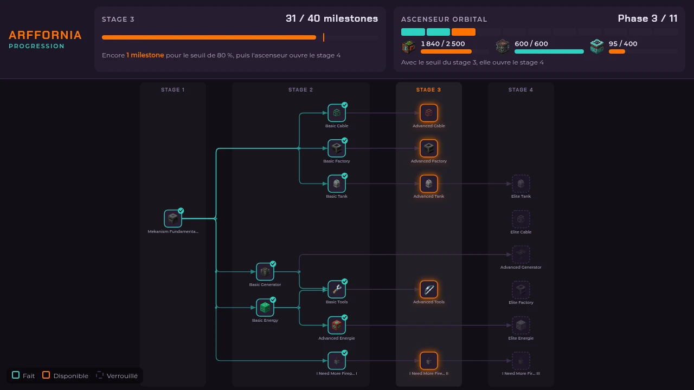
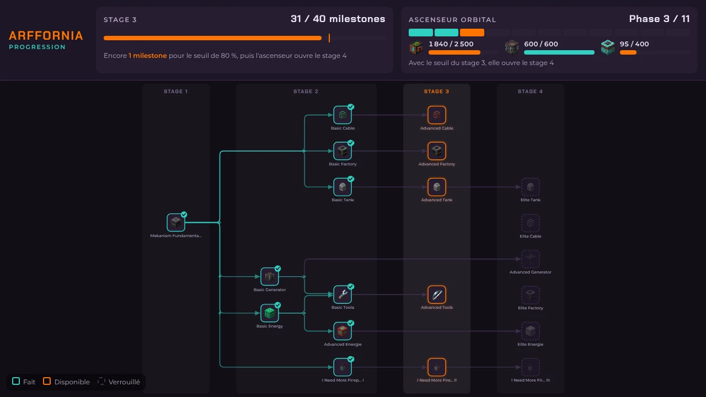
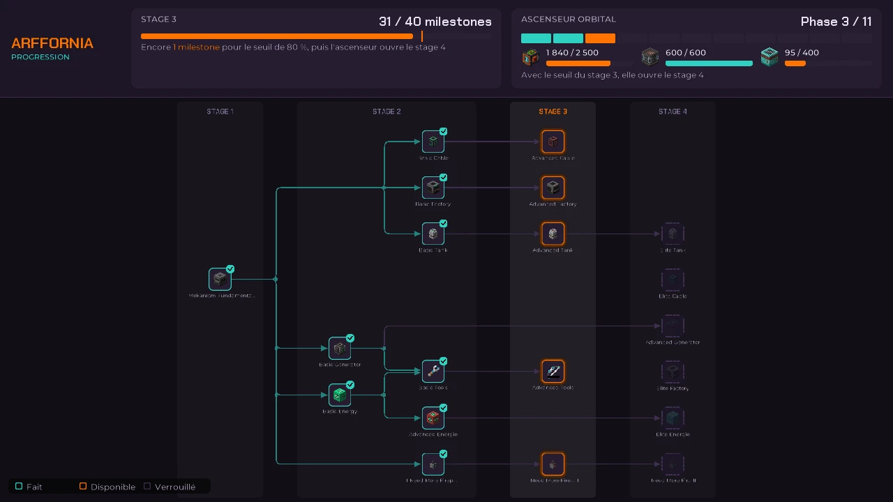
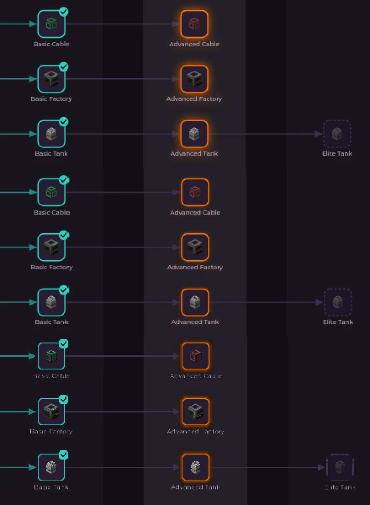

# 018 · Stage band prototype: numbers for D2

| | |
|---|---|
| **Status** | Input for D2 (work item 6). The decision is Brian's. |
| **Date** | 9 Nov 2026 |
| **Code** | [Arffornia_Mods#60](https://github.com/Arffornia/Arffornia_Mods/pull/60) (draft, not for main) |
| **Spec** | [018 UI framework](../018-ui-framework.md), work items 4 and 5 |

## What was built

One stage band of the progression graph, drawn in game twice from **one snapshot**
(`band.json`: positions, link paths and stage columns computed once by the web template's ELK
layout; the client never lays out):

- **Band**: Mekanism, stages 1 to 4 of the spec 017 fixture (20 milestones), player at stage 3, so
  all three states show: done, available, locked. Header with the stage and the orbital elevator, as
  Brian asked (not the HUD).
- **Native (D2 b)**: LDLib2 screen. Header and nodes are LDLib2 elements styled by an LSS stylesheet
  from the tokens; links, arrows, glow and dashed frames are drawn in Java; `GraphView` gives pan
  and zoom; item icons go through the normal item renderer.
- **Web (D2 a)**: WebGUI 2.0.0. One browser starts with the client and loads the band page
  off-screen at 1 fps. Opening the screen raises it to 60 fps and draws its texture. The page is the
  validated web template, fed by the same snapshot.

## Screenshots

Same band, same window (1280 × 720, GUI scale 3), full pack, in a world.

| Web template in Chrome (reference) | In game, web (WebGUI) | In game, native (LDLib2) |
|---|---|---|
|  |  |  |

Detail at 2×, top to bottom: Chrome, in-game web, in-game native.

| Pixel difference against the Chrome reference (normalised RMSE) | Value |
|---|---|
| In-game web | 3.9 % (mostly the glow animation phase) |
| In-game native | 9.1 % |

## Numbers

Full pack (333 mods), NeoForge 21.1.172, singleplayer world, 1280 × 720, GUI scale 3, `-Xmx10G`.
Machine: Ryzen 9 9900X, 32 GB, NixOS, **Xvfb with Mesa llvmpipe (software OpenGL)**. Run A: pack
with LDLib2, without WebGUI. Run B: pack with LDLib2 and WebGUI. Raw data:
[run A](bench-run-a.json), [run B](bench-run-b.json).

| Measure | Native (LDLib2) | Web (WebGUI, kept warm) |
|---|---|---|
| Build the screen on open (warm, 5 opens) | 5 to 13 ms | 0.8 to 1.4 ms |
| Build the screen, first open of the session | 81 ms | 1.4 ms |
| Open to first drawn frame | 144 to 154 ms (first: 328 ms) | 135 to 150 ms |
| Render-thread time per frame inside the screen | 2.8 ms mean, 3.1 ms p95 | 0.17 ms mean, 0.21 ms p95 (texture upload included) |
| Frame interval with the screen open (no screen: 142.7 ms) | 147.4 ms | 145.8 ms |
| CPU of the browser processes, screen open (page animating) | none | 15 % of one core |
| CPU of the browser processes, screen closed (warm, 1 fps) | none | 0 % |
| Memory of the browser processes (7 helpers) | none | 190 MB PSS (556 to 600 MB RSS) |
| Whole client, run B minus run A (PSS, in world, idle) | n/a | +272 MB (13 930 vs 13 658 MB) |
| Pack load to world (run A without WebGUI, run B with it) | 132 s | 126 to 134 s, no measurable difference |
| Browser ready / page loaded after client setup | n/a | 11 to 25 ms / 157 to 265 ms |
| First-launch download | none | 135 MB (Linux x64), unpacked 334 MB |

How to read them:

- **Software rendering hides frame cost.** At 7 fps under llvmpipe, open time is one frame interval
  for both, and frame intervals differ by less than the noise. The comparable numbers are the
  render-thread time inside the screen (native 2.8 ms, web 0.17 ms) and the browser's own CPU
  (15 % of a core while visible). On a real GPU the native cost should drop; it has not been measured.
- **Memory**: the helper processes are measured exactly (190 MB PSS). The browser process itself
  lives inside the JVM, so the whole-client delta (+272 MB) includes heap noise of about ±100 MB
  between runs. One run each.
- **WebGUI defaults add a second browser**: on join it opens a demo HUD page (`autoHudOnJoin`, and a
  web main menu). Arffornia would turn both off in `config/webgui/server.json`; with the HUD on,
  the client used +434 MB.

## Platform notes

| Topic | Finding |
|---|---|
| Browser runtime | WebGUI 2.0.0 no longer uses MCEF: it ships its own JCEF, **Chromium 135.0.7049.85** (CEF 135.0.20), not MCEF's Chromium 116 |
| Where it downloads from | Maven Central, `me/friwi/jcef-natives-<platform>/jcef-ca49ada+cef-135.0.20+ge7de5c3+chromium-135.0.7049.85/`; sizes 135 MB (Linux x64), 141 MB (Windows x64), 129 / 120 MB (macOS x64 / arm64). Not CinemaMod's server. No mirror setting |
| Where it looks for it | `$WMC_RUNTIME_DIR/135.0.20/<platform>/`, else `~/.wmc/runtime/…` (Windows: `%LOCALAPPDATA%\wmc\runtime\…`). A folder counts as installed when it holds a `.wmc-complete` file |
| Launcher pre-placement (work item 5b) | **Works**: an unpacked runtime copied to a fresh folder with its `.wmc-complete` marker, `WMC_RUNTIME_DIR` pointing to it: no download, browser ready before client setup ends |
| MCEF itself (for reference) | MCEF 2.1.6 (Oct 2024) downloads from `mcef-download.cinemamod.com` (mirror via `mcef.properties`, folder via `mcef.libraries.path`). Not tested, WebGUI no longer needs it |
| NixOS | Fails out of the box (`libcef.so: libnss3.so: cannot open shared object file`). **Works** when the game is started with nss, nspr, dbus, at-spi2-core, cups, libgbm, libdrm, expat, libxkbcommon, pango, cairo, glib, systemd (libudev), alsa-lib, the X libraries (libx11, libxext, libxcb, libxcomposite, libxdamage, libxfixes, libxrandr) and the JDK's own `lib/` (`libjawt.so`) on `LD_LIBRARY_PATH`. glibc version was not the problem |
| Helper crashes | A Chromium utility helper (`unzip.mojom.Unzipper`) aborted on `__stack_chk_fail` in a loop in one minimal-pack session; the band kept working. Cause not found |
| Windows, macOS | Not tested (no machine in this session) |
| LDLib2 and our NeoForge | **2.2.2 (Feb 2026) is the last LDLib2 build that accepts NeoForge 21.1.172**; 2.2.3 to 2.2.46 (current) require NeoForge ≥ 21.1.216. Native means a NeoForge bump of the pack or staying on an old LDLib2. 2.2.2 ran in the full pack next to KotlinForForge 5.8.0 without errors |
| FancyMenu | The pack draws FancyMenu's customisation bar over every screen (`show_customization_overlay = true`); turned off for the screenshots. Worth checking in the shipped config |

## What each renderer costs

| | Native (LDLib2) | Web (WebGUI) |
|---|---|---|
| Fidelity to the website | Close, not identical: see below | Identical: it is the same page |
| Text | Minecraft's glyph pipeline: no anti-aliasing, so text under about 9 px is unreadable (node captions at fit zoom). Needs one font definition per pixel size and GUI scale | Browser text, as on the website |
| Locked icons | No greyscale: the item renderer ignores tint, a veil stands in for the 40 % opacity. Greyscale needs a shader | Greyscale and opacity from CSS |
| Item icons | Live item renderer: any item, no icon export | Pre-rendered PNG icons (the website's icon atlas) |
| Hover, tooltips, pan and zoom | Built in (LDLib2 events, `GraphView`) | Built in the page; mouse and keyboard forwarding to the page is not wired in this prototype |
| Code for one band | about 360 lines of Java and 50 lines of LSS, a second renderer to keep in step | about 120 lines of Java; the page is the website component |
| Runtime cost | 2.8 ms render-thread time per frame while open, nothing while closed | 190 MB of helper processes plus the in-JVM browser, all session; 15 % of a core while open, idle when closed |
| Install cost | none | 135 MB per platform, hosted and installed by the launcher; NixOS needs the libraries above |

## For the decision

Spec 018 said (a) wins "if its memory and frame cost stay small". Measured here:

- **For (a)**: same pixels as the website, almost no render-thread cost, opens as fast as native
  once warm, launcher pre-placement works, current Chromium. One renderer instead of two.
- **Against (a)**: about 190 MB of helper processes (+272 MB measured for the whole client), a
  15 % core while the page animates, a 135 MB download per platform, NixOS and possibly other Linux
  setups need system libraries, Windows and macOS unverified.
- **For (b)**: no download, no extra processes, live item rendering, works on any platform the
  game runs on.
- **Against (b)**: a second renderer that is visibly not the website (small text, greyscale,
  glow), more code per screen, and current LDLib2 requires a NeoForge upgrade.
- **(c)** (native graph, web later for wiki and shop) keeps (b)'s costs for the graph and adds (a)'s
  for the content screens.

## To verify by hand before deciding

- Both screens on a real GPU, at 60 fps or more: frame time with the screen open, and the browser's
  CPU on a mid-range player PC.
- Windows and macOS: WebGUI starts, antivirus does not flag `jcef_helper`, the pre-placed runtime is
  picked up.
- Memory on an 8 GB player machine with the full pack.
- GUI scales 2 and 4, and a 1080p window: native text sharpness.
- Clicking and scrolling in the web screen (not wired in the prototype).
